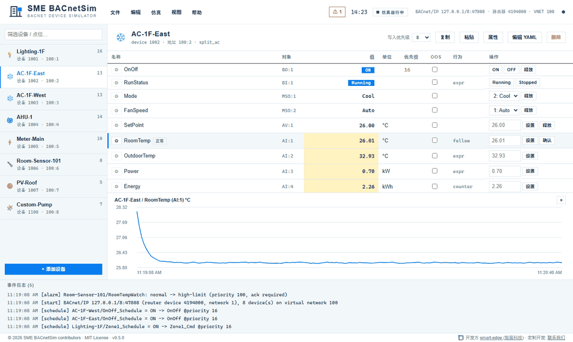
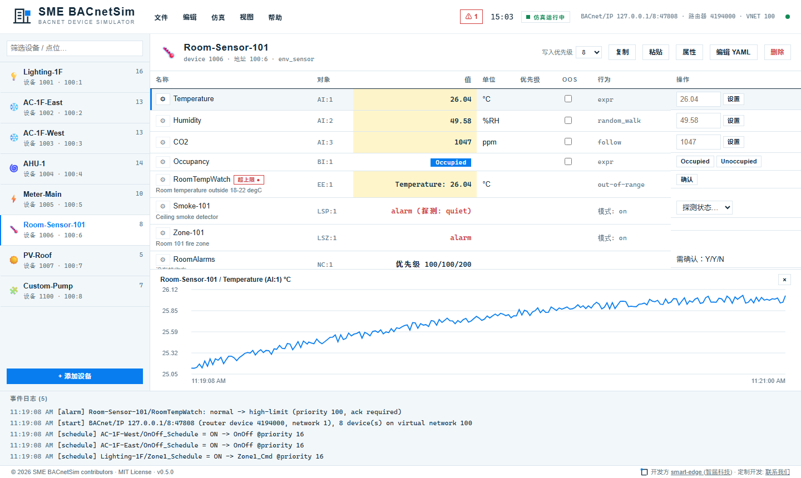
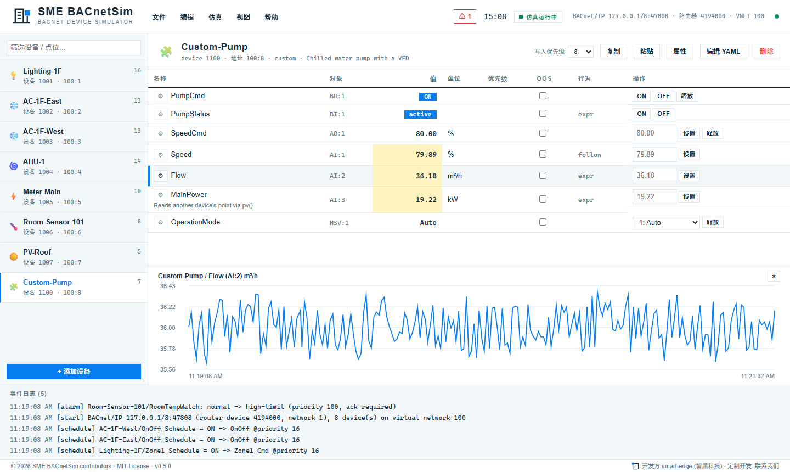
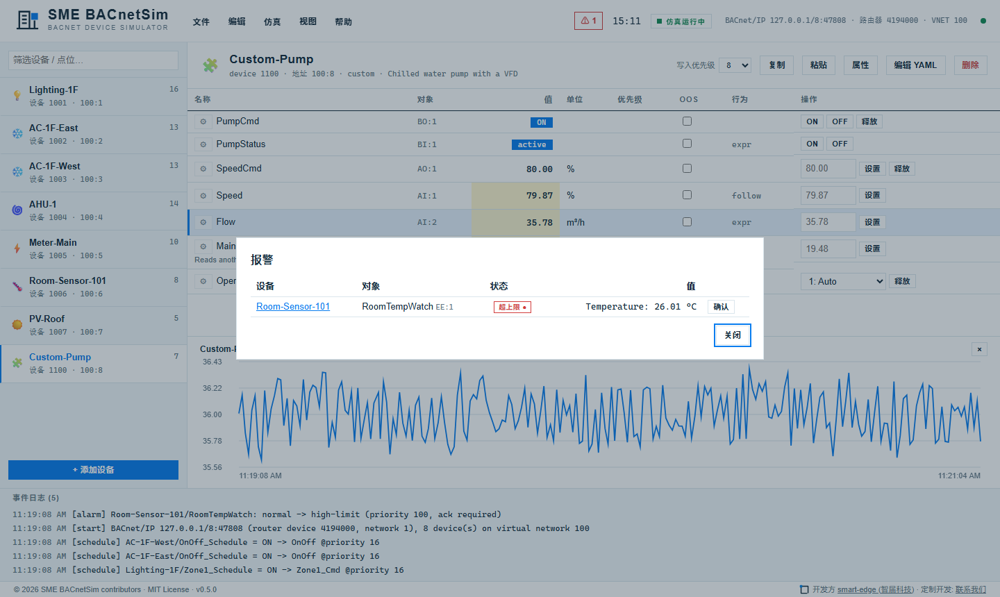
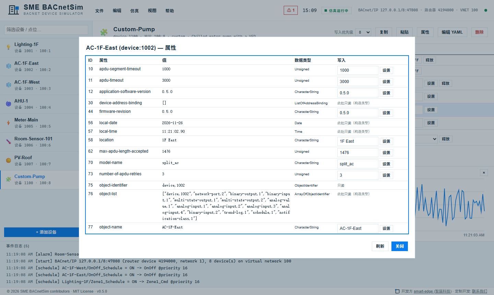
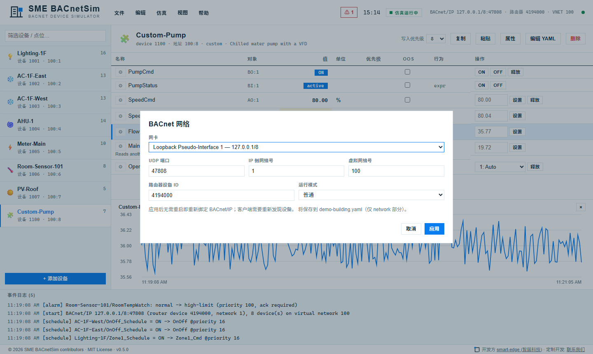
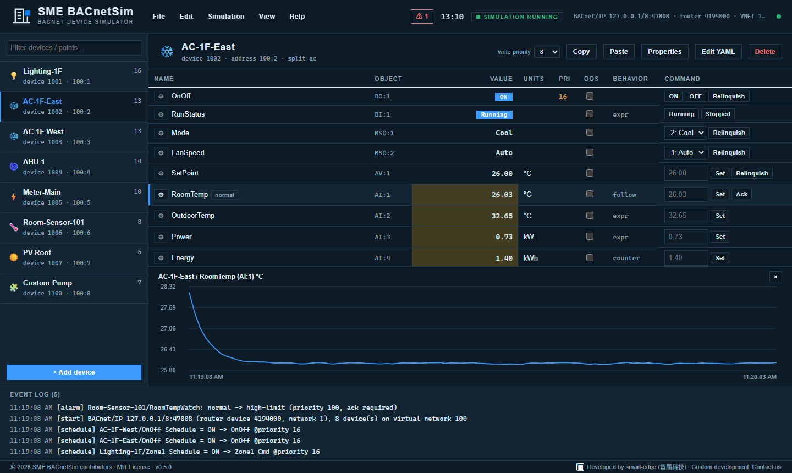

<p align="center"></p>

<h1 align="center">SME BACnetSim</h1>

<p align="center"><strong>一台电脑，模拟整栋楼的 BACnet 设备。</strong><br>照明、空调、AHU、电表、传感器、光伏共用一个 UDP 端口，附带实时 Web UI。</p>

<p align="center"><a href="https://smartedge-tech.com/zh/open-source/#bacnet-sim"><b>官网</b></a> · <a href="https://smartedge-tech-dev.github.io/sme-bacnet-sim/zh/"><b>文档</b></a> · <a href="https://github.com/smartedge-tech-dev/sme-bacnet-sim/releases/latest"><b>下载</b></a></p>

<p align="center"><a href="https://github.com/smartedge-tech-dev/sme-bacnet-sim/actions/workflows/ci.yml"></a> <a href="https://github.com/smartedge-tech-dev/sme-bacnet-sim/releases/latest"></a> <a href="https://github.com/smartedge-tech-dev/sme-bacnet-sim/blob/main/LICENSE"></a>  </p>

<p align="center"><a href="README.md">English</a> | <a href="README.ja.md">日本語</a> | <strong>简体中文</strong></p>

<p align="center"></p>

一个带实时 Web UI 的 BACnet/IP 设备模拟器。可以模拟照明控制器、空调、AHU、电能表、传感器、光伏逆变器，或任何用 YAML 描述的设备，并在浏览器中观察它们的数值变化，同时由真实的 BACnet 客户端（Yabe、Niagara、你自己的 EMS……）读取和控制这些设备。

- **一个端口承载多台设备。** 内置的 BACnet 路由器独占 UDP 47808；所有模拟设备都位于它背后的虚拟网络上（默认网络号 100），因此客户端只需一次 Who-Is 即可发现全部设备。
- **行为逼真。** 空调开启时室温会跟随设定值，电能随功率积分，照明会上报反馈和功率，光伏出力遵循日照曲线并受限发（curtailment）上限约束。
- **真实的 BACnet 语义。** 具有 16 级优先级数组和 relinquish 的可命令输出、out-of-service 覆盖、COV 增量，以及 Device / Network Port 对象。
- **可配置。** 可导入 / 导出 YAML 或 JSON，在浏览器中以 YAML 形式编辑任意设备，从模板添加设备，或保存回配置文件。
- **实时 UI。** 数值通过 WebSocket 推送，每个点位都有趋势图，并有记录 BACnet 与 UI 写入的事件日志。
- **英语、日语和简体中文。** UI 跟随浏览器语言；可在 视图 → 语言 中切换。

基于 [bacpypes3](https://github.com/JoelBender/BACpypes3)（asyncio BACnet 协议栈，支持 BACnet/IP、IPv6 和 BACnet/SC）和 FastAPI 构建。无需前端构建步骤。

SME BACnetSim 免费且采用 MIT 许可证，由 [smart-edge (智届科技)](https://smartedge-tech.com) 开发——可提供定制开发，详见 [商业支持与定制开发](#商业支持与定制开发)。

## 截图

<table>
  <tr>
    <td width="50%"><a href="https://raw.githubusercontent.com/smartedge-tech-dev/sme-bacnet-sim/main/docs/assets/screenshots/zh/objects.png"></a><br><sub>处于报警状态的 Event Enrollment、Notification Class 与 Life Safety</sub></td>
    <td width="50%"><a href="https://raw.githubusercontent.com/smartedge-tech-dev/sme-bacnet-sim/main/docs/assets/screenshots/zh/custom-device.png"></a><br><sub>用 YAML 从零定义的设备（expr / follow behavior）</sub></td>
  </tr>
  <tr>
    <td width="50%"><a href="https://raw.githubusercontent.com/smartedge-tech-dev/sme-bacnet-sim/main/docs/assets/screenshots/zh/alarms.png"></a><br><sub>报警列表与确认（Ack）</sub></td>
    <td width="50%"><a href="https://raw.githubusercontent.com/smartedge-tech-dev/sme-bacnet-sim/main/docs/assets/screenshots/zh/properties.png"></a><br><sub>属性查看器：读写任意属性</sub></td>
  </tr>
  <tr>
    <td width="50%"><a href="https://raw.githubusercontent.com/smartedge-tech-dev/sme-bacnet-sim/main/docs/assets/screenshots/zh/network.png"></a><br><sub>BACnet 网络设置（无需重启即可生效）</sub></td>
    <td width="50%"><a href="https://raw.githubusercontent.com/smartedge-tech-dev/sme-bacnet-sim/main/docs/assets/screenshots/en/overview-dark.png"></a><br><sub>深色主题</sub></td>
  </tr>
</table>

## 快速开始

```powershell
python -m venv .venv
.venv\Scripts\pip install -r requirements.txt
.venv\Scripts\python -m sme_bacnet_sim --config configs/demo-building.yaml
```

打开 http://127.0.0.1:8080/ 。选项：

| 选项 | 含义 |
|---|---|
| `-c, --config FILE` | YAML/JSON 配置（默认为 `configs/demo-building.yaml`） |
| `--ip 192.168.1.10/24` | BACnet/IP 使用的网卡地址（默认：自动检测，/24） |
| `--bacnet-port 47808` | BACnet/IP UDP 端口 |
| `--foreign-bbmd 192.168.2.1[:47808]` | 作为 foreign device 注册到该 BBMD（优先于配置文件） |
| `--foreign-ttl 300` | foreign device 的 Time-to-Live（秒，优先于配置文件） |
| `--host 0.0.0.0 --http-port 8080` | Web UI 绑定地址（默认仅限 localhost） |
| `--browser` | 启动时在浏览器中打开 Web UI（默认不打开；默认为 `--no-browser`） |

### 连接 BACnet 客户端

客户端会在 `<ip>:47808` 看到路由器（`device 4194000`），并通过它路由访问地址形如 `100:1`、`100:2` 的模拟设备（网络 100，MAC 1、2……）。在 Yabe 中：*Add device → BACnet/IP over UDP*，然后执行 *Who-Is*。

> **同一台 PC 的注意事项：** 在 Windows 上，同一台机器上的客户端可能收不到广播回复（Who-Is/I-Am），单播则正常。请把客户端运行在另一台机器上，或让模拟器与客户端绑定不同的网卡，或设置 `network.mode: bbmd` 并将客户端注册为 foreign device。

> **客户端使用其他 UDP 端口：** Who-Is / I-Am 广播发往模拟器的端口（默认 47808）。绑定在其他端口（如 47809）的客户端
> 收不到 I-Am 广播，因此发现不了设备。请让两边使用同一端口，或设置 `network.mode: bbmd` 并把客户端作为 foreign device
> 注册到模拟器（`<模拟器 IP>:47808`），I-Am 应答会转发给客户端。

### 在 Web 界面设置网络

*编辑 → BACnet 网络…*（或点击状态栏的 BACnet/IP 地址）可以修改网卡（按名称和地址/前缀列出，或选*自动检测*）、UDP 端口、
IP 侧与虚拟网络号、路由器设备 ID 和运行模式（普通 / BBMD / foreign device：BBMD 地址与 TTL）。*应用* 时先校验设置
（是否为本机地址、UDP 端口是否空闲、网络号是否不同、设备 ID 是否唯一），然后无需重启即重新绑定 BACnet/IP，
并把 `network:` 部分写回配置文件（其他部分和未保存的修改保持不变；`network:` 内的注释会丢失）。
`--ip` / `--bacnet-port` 等命令行选项在下次启动时仍然优先。修改后客户端需要重新发现设备。
Not supported：关闭 Read-Property-Multiple 或分段（segmentation）支持（始终开启）。

### Docker

```bash
docker run --rm --network host -e TZ=Asia/Tokyo ghcr.io/smartedge-tech-dev/sme-bacnet-sim:<ver>
```

Who-Is / I-Am 广播需要 `--network host`（Linux）。不指定 `TZ` 时容器时钟为 UTC，排程和界面时钟也按 UTC 计算
（镜像已包含 tzdata）。

### Foreign device 注册（跨子网）

需要让其他子网的客户端访问时，可把路由器端口作为 foreign device 注册到已有的 BBMD：
`network.foreign_device: {bbmd: "<ipv4>[:port]", ttl: <秒>}` 或 `--foreign-bbmd` / `--foreign-ttl`
（命令行优先；TTL 默认 300 秒，端口默认 47808）。注册使用 bacpypes3 的 foreign 链路层：每个 TTL 周期续订，
无应答时持续重试，停止或重新加载时注销（TTL 0）。结果（已注册 / NAK / 10 秒内无应答 / 过期）写入事件日志，
并在状态栏显示为 `FD → <bbmd> (…)`；快照 API 通过 `network.foreign_device` 提供。

Not supported：`foreign_device` 与 `mode: bbmd` 同时使用、BBMD 主机名（仅支持 IPv4 地址）、
读写 BBMD 的表（Read-Broadcast-Distribution-Table、Read-Foreign-Device-Table 等）。

## 配置

```yaml
network:
  ip: auto                # or "192.168.1.10/24"
  port: 47808
  network_number: 1       # IP-side network number
  virtual_network: 100    # network number of the simulated devices
  mode: normal            # or bbmd
  # foreign_device: {bbmd: "192.168.2.1:47808", ttl: 300}   # register with an external BBMD
  router: {device_id: 4194000, name: SME-BACnetSim-Router}

simulation:
  tick_seconds: 1.0
  time_scale: 1.0         # 60 = 1 simulated minute per second
  history_size: 600       # trend samples kept per point

devices:
  - device_id: 1002
    name: AC-1F-East
    template: split_ac             # optional
    params: {rated_kw: 2.8}        # template parameters
    objects:                       # add objects, or override template objects by name
      - {name: SetPoint, type: av, value: 24.0, commandable: true}
```

### 对象

| 键 | 说明 |
|---|---|
| `type` | `ai ao av bi bo bv msi mso msv acc pc loop file prog tl sch cal nc ee`（或完整名称，如 `analog-input`、`trend-log`、`schedule`、`calendar`、`notification-class`、`event-enrollment`） |
| `instance` | 可选；按类型自动编号 |
| `name`, `description` | `name` 同时也是表达式中的变量名 |
| `units` | BACnet 工程单位，例如 `degrees-celsius`、`kilowatts`、`percent` |
| `value` | 初始值（二进制：0/1，多状态：从 1 开始的索引） |
| `states` | 多状态文本 |
| `active_text`, `inactive_text` | 二进制文本（`"ON"`/`"OFF"` 需加引号——YAML 会把它们读成布尔值） |
| `commandable` | 用于 `av/bv/msv`；输出对象始终可命令 |
| `min`, `max`, `cov_increment` | 模拟量的上下限和 COV 增量 |
| `behavior` | 数值如何被模拟（见下文） |
| `log_object`, `log_property`, `log_interval`, `logging_type`, `client_cov_increment`, `buffer_size`, `enabled` | 仅用于 Trend Log（见下文） |
| `weekly`, `exceptions`, `default`, `targets`, `priority_for_writing`, `effective_period` | 仅用于 Schedule（见下文） |
| `dates` | 仅用于 Calendar（见下文） |
| `scale`, `prescale` | 仅用于 Accumulator（见下文） |
| `scale_factor`, `input_object` | 仅用于 Pulse Converter（见下文） |
| `controlled_object`, `manipulated_object`, `setpoint`, `setpoint_object`, `proportional_constant`, `integral_constant`, `derivative_constant`, `bias`, `action`, `update_interval` | 仅用于 Loop（见下文） |
| `file_type`, `access`, `content`, `path`, `read_only`, `program_state`, `instance_of`, `program_location` | 仅用于 File / Program（见下文） |
| `monitored_object`, `event_type`, `event_parameters`, `notification_class`, `event_enable`, `notify_type`, `time_delay`, `time_delay_normal` | 仅用于 Event Enrollment（见下文） |

#### Accumulator、Pulse Converter 与 Loop

```yaml
- {type: acc, name: EnergyPulses, units: kilowatt-hours, scale: 0.01, max: 99999999,
   behavior: {type: pulse, rate: "ActivePower * 100 / 3600"}}
- {type: pc, name: EnergyFromPulses, input_object: EnergyPulses, scale_factor: 0.01, units: kilowatt-hours}
- type: loop
  name: SupplyTempLoop
  controlled_object: SupplyTemp      # controlled-variable-reference (present-value)
  manipulated_object: CoolValve      # manipulated-variable-reference (present-value)
  setpoint_object: SupplyTempSP      # or a fixed setpoint: 16
  proportional_constant: 8
  integral_constant: 0.2
  min: 0                             # minimum-output
  max: 100                           # maximum-output
  units: percent                     # output-units
  priority_for_writing: 10
```

| 类型 | 键 |
|---|---|
| `acc`（Accumulator，23） | `value`（unsigned 计数）、`units`、`scale`（Scale，float scale，默认 1）、`max`（Max_Pres_Value，默认 4294967295；超过后计数回绕到 0）、`prescale`（`[multiplier, modulo_divide]`） |
| `pc`（Pulse Converter，24） | `value`、`units`、`scale_factor`（默认 1）、`input_object`（同一设备的 Accumulator → Input_Reference）、`cov_increment` |
| `loop`（Loop，12） | `controlled_object`、`manipulated_object`、`setpoint` 或 `setpoint_object`、`proportional_constant`（默认 1）、`integral_constant`（1/s，默认 0）、`derivative_constant`（s，默认 0）、`bias`（默认 0）、`action`（`direct` / `reverse`，默认 `direct`）、`update_interval`（模拟秒，默认 1；Update_Interval 属性单位为 ms）、`min` / `max`（输出上下限，默认 0 / 100）、`units`（Output_Units）、`priority_for_writing`（默认 16）、`cov_increment` |

- **Accumulator**：可由任意 behavior 驱动；`pulse` behavior 每秒累加 `rate` 个脉冲。
- **Pulse Converter**（带 `input_object`）：每个 tick 把 Accumulator 的计数增量（已考虑回绕）× Scale_Factor 累加到 Present_Value，Count 显示 Accumulator 的计数。没有 `input_object` 时它就是普通的 Real 值对象（可使用 behavior）。
- **Loop**（教科书式 PID，按模拟时钟每个 Update_Interval 运算一次）：`e = PV − setpoint`（direct）或 `setpoint − PV`（reverse）；`output = bias + Kp·e + Ki·∫e dt + Kd·de/dt`，限制在 Minimum_Output .. Maximum_Output，输出饱和时停止积分（anti-windup）。输出写入 Loop 的 Present_Value 和被操作对象（可命令对象写入 Priority_For_Writing 的 priority array，否则写 present value）。各常数、setpoint、action、上下限、更新周期和写入优先级都可用 WriteProperty 修改。有 `setpoint_object` 时 Setpoint 跟随该对象的值。Out of service 时不运算也不写输出。UI 显示输出以及 PV / SP。
- **COV**：按 bacpypes3 的定义，Pulse Converter 使用 COV increment 判据，Loop 使用通用判据（present-value / status-flags）。bacpypes3 没有 Accumulator 的 COV 判据，因此 Accumulator 不支持 SubscribeCOV（SubscribeCOVProperty 可用）。
- **CreateObject** 可创建 Accumulator 和 Pulse Converter（不带 input reference）；Loop 只能在配置文件中声明。**DeleteObject** 拒绝删除被 Pulse Converter 或 Loop 引用的对象。
- **EDE**：Accumulator 和 Pulse Converter 可导出（单位代码；Accumulator 的 `max` 列为 Max_Pres_Value）和导入；Loop 会被导出，但导入时跳过并给出警告（EDE 不携带引用和 PID 常数）。

Not supported：Prescale 的应用（仅保存其值）；Accumulator 的 Value_Set / Value_Before_Change / Value_Change_Time / Logging_Record / Pulse_Rate 和限值监视；Pulse Converter 的 Adjust_Value 语义（作为普通可写属性处理，不调整 Count 和 Present_Value）、Count_Before_Change / Count_Change_Time / Update_Time 以及 COV_Period 定期通知；这三类对象的 intrinsic reporting（`alarm` 会报错）；引用其他设备或 Present_Value 以外的属性。

#### File 与 Program

```yaml
- {type: program, name: AHU-Sequence, instance_of: AHU-Seq-v2, program_state: running}
- type: file
  name: MaintenanceLog
  file_type: text/plain            # File_Type (MIME type)
  access: record                   # stream (default) | record
  content: |-                      # or: path: logs/maintenance.txt (relative to the config file)
    2026-04-01 filter replaced
    2026-10-01 belt tension checked
- {type: file, name: Firmware, file_type: application/octet-stream, path: fw.bin, read_only: true}
```

| 类型 | 键 |
|---|---|
| `file`（File, 10） | `file_type`（默认 `text/plain`）、`access`（`stream` / `record`）、`content`（文本）或 `path`（启动时读入的文件，相对于配置文件）、`read_only`（默认 false） |
| `program`（Program, 16） | `program_state`（初始 `idle` / `running` / `halted`，默认 `idle`）、`instance_of`（默认为对象名）、`program_location` |

文件内容保存在内存中。stream 访问按字节处理；record 访问把每一行作为一条记录（不含换行符）。File_Size 为字节数
（record 访问为各记录长度之和），Record_Count 为记录数。**AtomicReadFile / AtomicWriteFile** 支持两种访问方式：
起始位置 / 记录号 `-1` 表示追加到末尾；起始位置超出末尾返回 `services / invalid-file-start-position`；访问方式不符返回
`invalid-file-access-method`；Read_Only 文件返回 `file-access-denied`；非 File 对象返回 `inconsistent-object-type`；
对象不存在返回 `object / unknown-object`。写入会更新 File_Size / Record_Count 与 Modification_Date（仿真时钟）。
以 `content` 定义的文件，写入内容会同步到配置，**Save** / 导出时一并保存（仅当内容是有效 UTF-8）；以 `path` 定义的文件
只在内存中修改，不会写回磁盘文件。File_Size、Modification_Date、File_Access_Method、Record_Count、Read_Only
对客户端只读（`write-access-denied`）。

Program：写入 Program_Change 立即生效并恢复为 `ready`：`load`、`run`、`restart` → `running`，`halt` → `halted`
（Reason_For_Halt `normal`，Description_Of_Halt "halted by request"），`unload` → `idle`，`ready` → 不变。任何状态下
都接受所有请求。UI 显示状态和 Program_Change 下拉菜单（`POST /api/devices/{id}/program/{instance}/change`）。
Program_State、Reason_For_Halt、Description_Of_Halt、Instance_Of 对客户端只读。

EDE 不携带文件内容、文件类型和访问方式：导入的文件为空的 stream 文件（并给出警告）；Program 只导入名称。

Not supported：过渡状态 `loading`、`waiting`、`unloading`；拒绝当前状态下无效的请求；真实的程序执行或异常
（`normal` 以外的 Reason_For_Halt）；通过写 File_Size 截断文件；Archive 的语义（仅为可写标志）；AtomicWriteFile 中
Record_Count 与实际记录数的一致性检查。这些细节只能依据付费的 ASHRAE 135 原文确定。

#### Trend Log

`type: tl`（或 `trend-log`）会创建一个 BACnet Trend Log 对象，用于记录**同一设备**内的另一个对象（轮询或按变化记录），并将采样保存在环形缓冲区中（最旧的记录会被丢弃，`stop-when-full` 为 false）：

```yaml
- {type: tl, name: RoomTemp_Log, log_object: RoomTemp, log_interval: 60, buffer_size: 1000}
- {type: tl, name: RoomTemp_Cov, log_object: RoomTemp, logging_type: cov, client_cov_increment: 0.5}
```

| 键 | 默认值 | 说明 |
|---|---|---|
| `log_object` | （必填） | 被记录对象的名称；必须存在于该设备中 |
| `log_property` | `present-value` | 目标对象的任意数值 / 枚举 / 布尔属性 |
| `log_interval` | `60` | **仿真**秒数（BACnet `log-interval` 以 1/100 秒上报）；仅用于轮询模式 |
| `logging_type` | `polled` | `polled` 或 `cov`（BACnet `logging-type`） |
| `client_cov_increment` | 目标对象的 `cov-increment` | 仅用于 `cov` 模式；被记录的实数值的最小变化量 |
| `buffer_size` | `1000` | 环形缓冲区大小 |
| `enabled` | `true` | `enable` 属性的初始值（也可通过 BACnet 和 UI 写入） |

采样基于仿真时钟，并以仿真日期时间作为时间戳，因此在 `time_scale: 3600` 时，一小时的真实时间会按配置的间隔产生一天的历史数据。当一个 tick 比 `log_interval` 更长时，错过的间隔会合并为一次采样。使用 **ReadRange** 读取缓冲区（按位置、按序列号、按时间，或不带范围以读取响应能容纳的全部内容）；`log-buffer` 不能通过 ReadProperty 读取。向 `record-count` 写入 `0` 会清空日志。`split_ac` 和 `power_meter` 模板各包含一个 Trend Log。EDE 导出 / 导入会携带 Trend Log（见下文 EDE 部分）。

**COV 记录**（`logging_type: cov`）：不按间隔采样，而是在被记录的值相对上一条记录变化至少达到增量时追加一条记录——增量为 `client_cov_increment`（若已设置，读回时为 `client-cov-increment`），否则在记录 present value 时取目标对象的 `cov-increment`，否则任何变化都记录；布尔 / 枚举 / 整数值在任何变化时都记录——或在目标对象的 status flags 变化时记录。启用日志且缓冲区为空时（清空之后同样如此）会立即记录第一条。变化在每个仿真 tick 检测一次，并以仿真时钟打时间戳；`log-interval` 读取为 0。
不支持：`triggered` 记录类型、记录其他设备的对象（因此也不支持对它们的 COV 订阅 / `cov-resubscription-interval`），以及缓冲区中的 log-status / time-change 记录。

#### Schedule 与 Calendar

`type: sch`（或 `schedule`）会创建一个 BACnet Schedule 对象，把它的值写入同一设备或**另一个模拟设备**的对象；`type: cal`（或 `calendar`）会创建一个 Calendar 对象，其 `present-value` 在所列日期上为 true。

```yaml
- {type: cal, name: Holidays, dates: ["2026-12-25", {from: "2026-12-29", to: "2027-01-03"}, "*-01-01"]}
- type: sch
  name: Light_Sch
  targets:                      # written via list-of-object-property-references
    - Zone1_Cmd                 # object of this device
    - {device: AHU-1, object: Fan_Cmd}            # object of another simulated device (name or device id)
    - {device: 300100, object: "binary-value:4"}  # device outside the simulator: listed, never written
  priority_for_writing: 16
  default: "OFF"                # schedule-default
  weekly:
    weekdays: [{time: "08:00", value: "ON"}, {time: "18:00", value: "OFF"}]
    sat: [{time: "09:00", value: "ON"}, {time: "12:00", value: null}]   # null = back to default
  exceptions:
    - {calendar: Holidays, priority: 10, times: [{time: "00:00", value: "OFF"}]}
    - {date: "2026-11-03", priority: 5, times: [{time: "10:00", value: "ON"}]}
    - {date: {from: "2026-08-10", to: "2026-08-14"}, priority: 6, times: [{time: "00:00", value: "OFF"}]}
    - {date: {weeknday: ["*", 6, 5]}, priority: 8, times: [{time: "13:00", value: "OFF"}]}  # last Friday
  effective_period: {from: "2026-01-01", to: "2027-12-31"}   # optional, default always
```

| 键 | 默认值 | 说明 |
|---|---|---|
| `weekly` | — | 键为 `mon`..`sun`，或 `weekdays` / `weekend` / `daily`；每个键对应一个 `{time: "HH:MM[:SS]", value}` 的列表 |
| `exceptions` | — | 特殊事件：`date`（形式与 Calendar 的 `dates` 相同：带 `*` 通配符的 `YYYY-MM-DD`、`{from, to}` 范围或 `{weeknday: [...]}`）或 `calendar`（Calendar 对象名称）二选一，加上 `priority` 1–16（1 优先级最高）和 `times` |
| `default` | 0 / `OFF` / 1 | schedule-default；`weekly` / `exceptions` 至少需要一个 |
| `targets` | 无 | 输出或值对象，类型须一致：名称（本设备）或 `{device, object}`；`device` 是模拟设备的名称或 id，`object` 是名称或 `type:instance`（`av:3`、`binary-output:1`）。不在模拟器中的设备 id 需要 `object: type:instance`；它会连同其 `deviceIdentifier` 出现在 `list-of-object-property-references` 中，但会被跳过（启动时记录一次日志），也绝不会通过网络写入 |
| `priority_for_writing` | `16` | 可命令目标使用的 priority-array 槽位 |
| `effective_period` | 始终有效 | `{from, to}`；在此范围之外，Schedule 保持其值且不写入任何内容 |
| `dates`（Calendar） | `[]` | 日期、`{from, to}` 范围，或 `{weeknday: [month, week-of-month, day-of-week]}`（`*` = 任意；月份 13 / 14 = 奇数月 / 偶数月；周 1–5 = 第 1–7 日 … 第 29–31 日，6 = 当月最后 7 天，7–9 = 其之前的 7 天区块；星期 1 = 星期一） |

值类型由目标决定：模拟量 → REAL，二进制 → ENUMERATED（`0/1`、`true/false`、`ON/OFF`、`active/inactive` 或目标自己的文本），多状态 → UNSIGNED 状态号。没有目标时，值为 REAL。时间请加引号（`"18:00"`）：不加引号时，YAML 1.1 会把 `18:00` 读成数字 1080（仍然能被理解，但加引号更清晰）。

Schedule 运行在**仿真时钟**上，因此 `time_scale` 会让它们快进。bacpypes3 自带的 Schedule 解释器使用墙上时钟和 asyncio 定时器，所以模拟器保留了其 Schedule 对象和求值规则，但每个 tick 都根据仿真日期时间重新求值。当值发生变化，或到达 weekly / exception 日程中的某个时间条目时（即使值相同，因此预定动作会覆盖操作员的修改），会设置 Schedule 的 `present-value`，并以 `priority_for_writing` 将该值写入每个目标（不可命令的值对象则直接写入 `present-value`）；在两次预定动作之间不会写入任何内容。因此客户端的 relinquish 可以正常工作；Schedule 会在下一个时间条目再次写入。位于其他模拟设备中的目标会被直接写入该设备的对象。目标所在设备执行 ReinitializeDevice 时会重新下发预定值；COV 订阅会保留。`weekly-schedule`、`exception-schedule` 和 `schedule-default` 可通过 BACnet 写入，并在下一个 tick 生效（类型错误的值会把 `reliability` 设为 `configuration-error`）；exception 条目可使用日期、日期范围、weekNDay 或 Calendar 引用。写入的内容会以 `weekly` / `exceptions` / `default` 保留在配置中（Save / Export；binary 值记为 0 / 1，只改写有变化的键，模板中的 Schedule 以覆盖条目保存）；配置无法表示的内容（类型错误、不是本设备 Calendar 的 Calendar 引用、目标不接受的值）不会保留，配置保持最后一次有效的内容。`exception-schedule` 是数组，因此 Add/RemoveListElement 返回 `property-is-not-a-list`。Calendar 的 `date-list` 同样可写；写入 `list-of-object-property-references` 会改变目标（本设备或其他模拟设备中与 Schedule 同类的输出 / 值对象的 present-value，或模拟器之外的设备；其他引用返回 `value-out-of-range`），两者都会保留在配置中（Save / Export）。客户端对 Schedule 自身 `present-value` 的写入（须使用 Schedule 的数据类型，否则返回 `invalid-data-type`）会以 `priority_for_writing` 转发给所有目标，并保持到下一个预定时间条目；无论是否设置了 `out-of-service`，该写入都会被接受。

不支持：写入模拟器之外设备上的目标（没有网络 WriteProperty）。

`lighting` 模板带有一个切换 `Zone1_Cmd` 的 Schedule（工作日 08:00 开、18:00 关），`split_ac` 模板带有一个控制 `OnOff` 的 Schedule（工作日 09:00–18:00）；可通过模板参数 `schedule: false` 禁用它们。UI 会列出 Schedule 和 Calendar 及其当前值和下一次切换；点击某一行可查看 weekly / exception 表。EDE 导出会把它们列为对象类型 17 / 6；EDE 导入会跳过它们。

#### 报警（Intrinsic Reporting）

`type: nc`（或 `notification-class`）会创建一个 Notification Class 对象；其 `instance` 即 Notification Class 编号。Web UI 在设备的对象列表中列出 Notification Class（只读：优先级、需确认标志和接收方；请在配置中编辑）。

| 键 | 含义 |
|---|---|
| `priority` | `[to-offnormal, to-fault, to-normal]`，默认 `[100, 100, 200]` |
| `ack_required` | 3 个标志，默认 `[true, true, false]` |
| `recipients` | `{device: <id>` 和 / 或 `address: "<net>:<mac>" \| "<ip>:<port>", process_id, confirmed, transitions: [3 flags], from_time, to_time, days}` 的列表 |

仅通过 `device` 指定的接收方会用 Who-Is 解析（另一个模拟设备则直接解析；否则 Who-Is 会经由路由器发出，因此接收方必须监听模拟器的 UDP 端口，通常是另一台主机上的 BMS）。给出 `address`（`"<ip>:<port>"` 表示 BACnet/IP 一侧的站点）则跳过查找。

任何值对象都可以带一个 `alarm` 块来启用 intrinsic reporting：

```yaml
- type: ai
  name: RoomTemp
  alarm: {notification_class: NC1, high_limit: 30, low_limit: 15, deadband: 0.5, time_delay: 60}
- {type: bi, name: FilterAlarm, alarm: {notification_class: 1, alarm_value: active}}
- {type: msi, name: Status, states: [Stopped, Running, Fault], alarm: {notification_class: 1, fault_values: [Fault]}}
```

| 键 | 含义 |
|---|---|
| `notification_class` | 同一设备中某个 notification-class 对象的名称或 instance |
| `high_limit`, `low_limit`, `deadband`, `limit_enable` | 模拟量（OUT_OF_RANGE）；`limit_enable` 为 `[low, high]`，默认取已设置的限值 |
| `alarm_value` | 二进制（CHANGE_OF_STATE）：`active` / `inactive` |
| `alarm_values`, `fault_values` | 多状态：状态号或文本；fault value 会使对象进入 `fault` |
| `time_delay`, `time_delay_normal` | **仿真**秒数（默认 0 / `time_delay`） |
| `event_enable` | `[to-offnormal, to-fault, to-normal]`，默认全部为 true |
| `notify_type` | `alarm`（默认）或 `event` |

事件状态基于仿真时钟求值（延时随仿真速度变化，暂停时停止计时；写入会立即求值）。状态转换会更新 Event_State、Event_Time_Stamps、Acked_Transitions 和 in-alarm 状态标志，以 Confirmed / UnconfirmedEventNotification 发送给接收方，并出现在事件日志中。模拟器会应答 AcknowledgeAlarm、GetEventInformation、GetAlarmSummary 和 GetEnrollmentSummary（支持全部过滤条件，包括 enrollment filter = 对象所属 Notification Class 的接收方 + process identifier）；Web UI 在每一行显示报警徽标和 **确认** 按钮，在标题栏显示活动报警数，并提供 *视图 → 报警*。`split_ac`、`ahu` 和 `power_meter` 模板会添加 `NC1`（无接收方）和若干报警；设置模板参数 `alarms: false` 可去掉它们。`split_ac` 的 RoomTemp 上限（模板参数 `high_limit`，默认 35 °C）是一个高于模板环境温度峰值（33 °C）的过热报警，因此在空调按其 Schedule 运行期间，演示可以无报警地启动和运行；若想看到报警，请从客户端写入 `high-limit`（例如 28）。

向 `event-enable`、`limit-enable`、`high-limit`、`low-limit`、`deadband`、`time-delay`、`time-delay-normal`、`notification-class`（必须是该设备的某个 notification-class 对象）以及 `alarm-value` / `alarm-values` 进行的 BACnet 写入（WriteProperty / WritePropertyMultiple）会生效并写入配置，因此 保存 / 导出 会保留它们。`acked-transitions` 为只读（WriteProperty 返回 `write-access-denied`）。

WritePropertyMultiple 会先校验每一项（对象存在、属性存在、数组索引、数据类型、上述报警属性规则、可命令对象的 Priority_Array），只要有一项失败就不写入任何内容；错误会指明第一个失败的对象 / 属性。仅在对象自身写入钩子内部完成的值检查（例如 Trend Log / Schedule 的范围检查）仍在写入过程中执行，因此此类失败可能导致请求中靠前的项目已被应用。

bacpypes3 0.1.0 无法解码列表为空的 GetAlarmSummary / GetEnrollmentSummary ACK（即过滤条件没有匹配到任何内容），并将其报告为 `invalid-tag`；模拟器自身能正确编码空 ACK，并为运行在同一进程内的 bacpypes3 客户端修补了解码器（`sme_bacnet_sim/alarm.py`）。其他 bacpypes3 0.1.0 客户端在应用同样的修复之前会看到同样的错误。
已处于 `offnormal` 的多状态对象变为另一个报警值时，会在 `time_delay` 之后产生一次新的 `offnormal -> offnormal` 转换（及通知）。

限制：bacpypes3 自带的 intrinsic reporting 算法运行在墙上时钟上，因此模拟器使用自己的实现（见 `sme_bacnet_sim/alarm.py`）。

不支持：确认通知（通知类型 `ack-notification`）。AcknowledgeAlarm 会得到应答并更新 Acked_Transitions，但不会向接收方发送通知。除上述预先校验之外，WritePropertyMultiple 严格的全有或全无语义（回滚已应用的写入）也不支持。SME BACnetSim 免费，且仅基于公开资料构建；只能依据付费的 ASHRAE 135 文本才能确定的行为一律不予实现。

#### 事件登记（Event Enrollment，algorithmic reporting）

`type: ee`（或 `event-enrollment`）创建 Event Enrollment 对象：监视同一设备中另一个值对象的 present-value，
并通过 Notification Class 发送通知，因此没有 `alarm` 块的点（例如模板里的温度）也能产生报警：

```yaml
- type: ee
  name: RoomTempWatch
  monitored_object: Temperature
  event_type: out-of-range
  event_parameters: {low_limit: 18, high_limit: 28, deadband: 0.5}
  notification_class: RoomAlarms
  time_delay: 60
- {type: ee, name: ModeWatch, monitored_object: OperationMode, event_type: change-of-state,
   event_parameters: {alarm_values: [Maintenance]}, notification_class: 1, notify_type: event}
```

| 键 | 含义 |
|---|---|
| `monitored_object` | 同一设备中值对象的名称（Object_Property_Reference = 其 present-value） |
| `event_type` | `out-of-range`（模拟量，不含 Accumulator）或 `change-of-state`（二进制 / 多态） |
| `event_parameters` | out-of-range：`low_limit`、`high_limit`（均必填、始终启用）、`deadband`；change-of-state：`alarm_values`（状态编号或文本，二进制用 `active` / `inactive`） |
| `notification_class` | 同一设备中 notification-class 对象的名称或实例号 |
| `time_delay`、`time_delay_normal` | **模拟**秒（默认 0 / `time_delay`）；`time_delay` 即 Event_Parameters 中的 Time_Delay |
| `event_enable` | `[to-offnormal, to-fault, to-normal]`，默认全部 true |
| `notify_type` | `alarm`（默认）或 `event` |

事件登记与 intrinsic reporting 共用同一套事件状态机、通知、AcknowledgeAlarm、
GetEventInformation / GetAlarmSummary / GetEnrollmentSummary 以及 Web UI（带徽标和 **确认** 按钮的行、*视图 → 报警*）。
对 `event-parameters`（同一事件类型）、`event-enable`、`notify-type`、`time-delay-normal`、`notification-class`、`event-enrollment` 的
BACnet 写入会生效并写回配置；`acked-transitions` 只读。演示配置的 `Room-Sensor-101` 中有一个示例。EDE 导出包含事件登记
（对象类型 9）；EDE 导入会跳过并给出警告（EDE 不含监视对象和参数）。

Not supported：事件类型 `floating-limit`、`change-of-value` 及其它所有类型（其精确算法仅在 ASHRAE 135 中规定）、
事件登记的故障检测（无 `fault` 状态 / change-of-reliability）、监视其它设备的对象或 present-value 以外的属性、
通过 BACnet 写入修改 `event-type` / `object-property-reference`、用 CreateObject / DeleteObject 创建 / 删除事件登记。
被事件登记监视的值对象不能删除。

#### Life Safety Point 与 Life Safety Zone

```yaml
      - {type: lsp, name: Smoke-101, description: Smoke detector}   # life-safety-point (object type 21)
      - type: lsp
        name: Heat-101
        value: quiet               # initial state (BACnetLifeSafetyState: quiet, pre-alarm, alarm, fault, ...)
        mode: "on"                 # BACnetLifeSafetyMode (default on; quote on / off in YAML)
        accepted_modes: ["on", "off", test]   # default [off, on, test]
        operation_expected: none   # BACnetLifeSafetyOperation, read-only (default none)
        silenced: unsilenced       # initial BACnetSilencedState
        behavior: {type: random_alarm, probability: 0.001, state: alarm}  # optional, per sim second
      - {type: lsz, name: Zone-101, zone_members: [Smoke-101, Heat-101]}  # life-safety-zone (object type 22)
```

完整的状态机只在 ASHRAE 135 中定义，模拟器使用简化模型：

- **Tracking_Value** 是探测器的实时状态。可在 UI（行的探测状态菜单，
  `POST /api/devices/{id}/life-safety/{type:instance}/state`）或用可选的 `random_alarm` behavior（随机变为
  `state`，下一个 tick 回到 `quiet`）设置。对 BACnet 客户端只读。
- **Present_Value** 在 Tracking_Value 非 `quiet` 时跟随它，回到 `quiet` 后保持**锁存**直到 reset。
  对 present-value 的 BACnet 写入仅在 out-of-service 时接受。
- **Zone** 的 Tracking_Value 取 Zone_Members 顺序中第一个非 `quiet` 成员的 present value（全部 `quiet` 则为
  `quiet`）。这是简化：不应用状态之间的严重程度顺序。
- **LifeSafetyOperation**：`silence` / `silence-audible` / `silence-visual` 置位、`unsilence*` 清除 Silenced 的
  audible / visible 部分；`reset` / `reset-alarm` / `reset-fault`（此处相同）把 Tracking_Value 复制到
  Present_Value 并解除消音；`none` 不做任何事。对 Zone 的操作也作用于其成员；不带 object identifier 时作用于
  设备的所有 Life Safety 对象。厂商自定义操作返回 `services` / `optional-functionality-not-supported`，其它对象
  类型返回 `object` / `unsupported-object-type`。所有操作都写入事件日志。
- **mode** 可写，但必须属于 accepted-modes（否则 `property` / `value-out-of-range`）；**zone-members** 可写
  （WriteProperty、AddListElement / RemoveListElement），并以成员名写回配置（指向其它设备的引用被忽略）。
- ReinitializeDevice 恢复配置的状态。EDE 导出包含它们（object type 21 / 22，值为状态编号），EDE 导入保留
  类型、名称和状态。

不支持：change-of-life-safety 事件报告（不评估 alarm-values、life-safety-alarm-values、fault-values 及事件属性）、
状态的严重程度顺序与依赖模式的状态转换、maintenance-required / direct-reading / setting 的行为、用
CreateObject / DeleteObject 创建 / 删除 Life Safety 对象。

### 设备管理服务

每个模拟设备还提供以下服务（bacpypes3 0.1.0 在服务端对其中大部分未实现或存在缺陷，因此模拟器在 `sme_bacnet_sim/engine.py` / `sme_bacnet_sim/devmgmt.py` 中自行实现）：

- **COV 增量默认值**（未设置 `cov_increment` 的模拟量对象）：带 `behavior` 的点位（每个 tick 都会变化）取其量程的 1 %（对象的 `min` / `max`，否则取 behavior 的 `min` / `max`），否则取按单位的默认值（°C / kW / kWh / A 为 0.1，% / %RH / V / m³/h 为 0.5，W / Pa 为 1，ppm / lx / W/m² 为 5，Hz 为 0.01；见 `sme_bacnet_sim/engine.py` 中的 `_UNIT_COV`），否则为 `0`；没有 behavior 的点位保持 `0`（= 任何变化都通知）。如需覆盖，请显式设置 `cov_increment`。
- **SubscribeCOV**（confirmed / unconfirmed，带生存期），适用于所有值对象：当 presentValue 的变化至少达到 `covIncrement`（模拟量）时发送通知，无论变化来自 behavior、BACnet 写入还是 UI；任何 status-flags 变化（alarm、fault、out-of-service）时也会发送。**SubscribeCOVProperty** 可用于任意属性，并使用客户端指定的 COV 增量（默认：present-value 取对象的 `covIncrement`）；通知中携带该属性和 status flags。
- **CreateObject / DeleteObject**，适用于值对象（AI/AO/AV/BI/BO/BV/MSI/MSO/MSV、Accumulator、Pulse Converter），可按对象类型（取第一个空闲 instance）或按对象标识符创建，并可带可选的初始值：object-name、present-value、description、units / cov-increment（模拟量）、active-text / inactive-text（二进制）、state-text（多状态，默认 `State 1`、`State 2`）、out-of-service。创建的对象会被追加到运行中配置里该设备的 `objects`（因此 保存 / 导出 会保留它），并立即出现在 UI 中。删除会将其从 `objects` 中移除；如果该对象来自模板，其名称会被加入设备的 `removed` 列表，模板展开时会跳过该列表中的名称（从 `removed` 中删除该名称即可恢复模板对象；创建同名对象也会将其从 `removed` 中移除）。不可删除（`object` / `object-deletion-not-permitted`）：Device 对象、Network Port、Trend Log、Schedule、Calendar、Notification Class，以及被 Trend Log 记录或被 Schedule 写入的值对象。创建失败时使用 CreateObject-Error 并带上出错元素的编号（`dynamic-creation-not-supported`、`object-identifier-already-exists`、`duplicate-name`、其他属性为 `write-access-denied`、`invalid-data-type`）。
- **TimeSynchronization / UTCTimeSynchronization**（发给设备，或发给路由器 / 广播）：移动仿真时钟使其显示收到的时间（UTC 会按主机时区转换）；已流逝的仿真时间继续累计，Schedule 立即重新求值，Trend Log 在新时钟上继续记录。*仿真 → 与电脑时钟同步*（或 `POST /api/simulation {"set_time": ...}`）在 UI 中实现相同效果。
- **DeviceCommunicationControl** 的 enable / disable / disable-initiation，可带以分钟为单位的可选持续时间，按**墙上时钟**计时（标准中该持续时间是现实世界的超时，与仿真速度无关）。禁用期间，设备会忽略除 DeviceCommunicationControl 和 ReinitializeDevice 之外的一切请求，并且不发送任何内容（不发 I-Am、COV 或事件通知）；disable-initiation 仍会应答请求和 Who-Is，但不会主动发起其他任何操作。UI 中的设备标题栏会显示该状态，并带有 *启用通信* 按钮。
- **ReinitializeDevice** warmstart：数值恢复为配置的初始值，priority array 被 relinquish，out-of-service 被清除，behavior 和报警被重置（事件状态为 normal，全部已确认），通信重新启用。Coldstart：同上，并且清空 Trend Log 缓冲区。其他状态返回 `services` / `optional-functionality-not-supported`。

这些服务相关的设备键：

```yaml
  - device_id: 1002
    name: AC-1F-East
    dcc_password: secret      # DeviceCommunicationControl password (default: none = not checked)
    reinit_password: boot     # ReinitializeDevice password (default: none = not checked)
    removed: [FilterAlarm]    # template objects deleted with DeleteObject (written by the simulator)
```

密码错误会返回 `security` / `password-failure`。

### TextMessage、PrivateTransfer 与列表元素服务

- 模拟设备收到的 **ConfirmedTextMessage / UnconfirmedTextMessage** 写入事件日志（类别 `text-message`：发送方地址
  与设备、priority、message class、正文）。模拟设备可通过 `POST /api/devices/{id}/text-message`
  `{"message": "...", "address": "100:2", "priority": "normal", "message_class": 5, "confirmed": false}` 发送
  （`address` 默认为全局广播 `*:*`，不能 confirmed；`message_class` 为数字或文本）。
- **ConfirmedPrivateTransfer / UnconfirmedPrivateTransfer** 写入事件日志（类别 `private-transfer`）。confirmed 请求按
  设备 `private_transfer` 列表的声明应答：`result: echo`（默认）把 service parameters 原样作为 result block 返回，
  `null` 不带 result block，字符串 / 整数 / 实数 / 布尔值则返回该值。没有匹配项时返回 ConfirmedPrivateTransfer-Error
  `services` / `optional-functionality-not-supported`：设备支持该服务，只是不支持这个 vendor / service number，
  因此不用表示整个服务缺失的 `unrecognized-service` reject。
- **AddListElement / RemoveListElement** 适用于任何可写的列表型属性（如 Notification Class 的 recipient-list、
  Calendar 的 date-list、Schedule 的 list-of-object-property-references、Life Safety Zone 的 zone-members）。元素按
  bacpypes3 属性类型解码，新列表与整表 WriteProperty 完全相同地写入（相同检查与后续处理）。添加时已存在的元素被
  忽略。错误（Add/RemoveListElement-Error）：未知对象 / 属性、`services` / `property-is-not-a-list`（不是列表）、
  `property` / `property-is-not-an-array`（指定了数组下标）、`write-access-denied`、`invalid-data-type`，删除时不在
  列表中的元素返回 `services` / `list-element-not-found`（带第一个此类元素的从 1 开始的序号）。写回配置（与 WriteProperty 相同，来自模板的对象以覆盖条目保存）：zone-members、
  recipient-list（同时立即用于发送通知）、date-list 与 list-of-object-property-references（Schedule 改为写入新目标）。

```yaml
  - device_id: 1006
    name: Room-Sensor-101
    private_transfer:
      - {vendor_id: 999, service_number: 1}              # result: echo (default)
      - {vendor_id: 999, service_number: 2, result: 42}  # fixed value
```

不支持：PrivateTransfer 参数的厂商自定义含义（不解码）、路由器设备上的 TextMessage、以及除上述检查外 ASHRAE 135
仅针对个别属性规定的 AddListElement / RemoveListElement 规则。

### Behavior

| `type` | 参数 | 示例 |
|---|---|---|
| `sine` | `min max period phase noise` | 每日或周期性的波动 |
| `random` | `min max` | 均匀噪声 |
| `random_walk` | `min max step` | 漂移的传感器 |
| `expr` | `expr` | `"Zone1_Cmd"`、`"1.732 * Voltage * Current * PowerFactor / 1000"` |
| `follow` | `target tau noise` | 对目标的一阶滞后：`"SetPoint if OnOff else 30"` |
| `counter` | `rate` | 按 单位/秒 积分：`"Power / 3600"` → kWh |
| `pulse` | `rate` | Accumulator 每秒脉冲数（小数部分结转）：`"ActivePower * 100 / 3600"` |
| `replay` | `file column interpolate loop offset` | 回放 CSV 时间序列（见下） |

**CSV 回放**（`replay`）：CSV 第 1 列是时间戳（经过时间 `HH:MM:SS` 或秒数，或 ISO 日期时间），其余各列是数值序列。
每个点指定 `file` 和 `column`，因此一个 CSV 可驱动多个点（文件只解析一次）。相对路径以配置文件所在目录为基准。
回放时刻 0 是第一行，随仿真时钟推进（跟随 `simulation.time_scale`）。`interpolate: linear`（默认）或 `step`
（保持上一行）；二值 / 多态点始终按 step 保持（`active` / `inactive` / `1` / `0`、状态编号）。`offset` 从中途开始
（`"06:00:00"`、秒数，ISO CSV 可用 ISO 日期时间），`loop: true` 循环播放，否则保持最后一个值。空单元格保持上一个值。
非法时间戳、时间倒退的行、不存在的列在加载配置时报错。点的行显示回放位置（例 `replay 06:12:30 (26%)`）。
示例：`configs/replay-example.yaml` 与 `configs/data/day-profile.csv`：

```csv
time,oat,rh,occupied,mode
00:00:00,13.8,71,inactive,1
08:00:00,17.2,64,active,2
19:00:00,20.2,56,inactive,1
24:00:00,13.8,71,inactive,1
```

```yaml
- {type: ai, name: OutdoorTemp, units: degreesCelsius,
   behavior: {type: replay, file: data/day-profile.csv, column: oat, loop: true, offset: "06:00:00"}}
- {type: bi, name: Occupied,
   behavior: {type: replay, file: data/day-profile.csv, column: occupied, loop: true, offset: "06:00:00"}}
```

表达式是沙箱化的 Python 表达式。可用名称：设备内的对象名称、`t`（仿真秒数）、`dt`、`hour`（仿真时钟，0–24）、用于读取其他设备的 `pv("Device", "Object")`，以及 `sin cos exp log sqrt pi abs min max round clamp random uniform noise gauss`。

处于 **out of service** 的对象会停止跟随其 behavior，这就是注入固定值或故障的方法。在 UI 中写入模拟输入时，会自动将其置为 out of service。

### 模板

`lighting`、`split_ac`、`ahu`、`power_meter`、`env_sensor`、`pv_inverter`、`custom`——见 [sme_bacnet_sim/templates.py](sme_bacnet_sim/templates.py)。添加自己的模板只需一个约 20 行的函数。

### EDE 导入 / 导出

SME BACnetSim 可以读写 EDE 文件（B.I.G.-EU Engineering Data Exchange，布局 2.3），这是大多数 BACnet 工具和集成商之间交换的 CSV 点表。

- **导出**：`EDE` 按钮（`GET /api/config/export?format=ede`）下载一个 zip，其中包含主文件 `sme-bacnet-sim-ede.csv`（每个对象一行，另有一行 object-type 为 8 的设备行；使用数字形式的对象类型和单位代码；模板已展开）以及状态文本文件 `sme-bacnet-sim-ede-statetexts.csv`（二进制对象：Text 1 = inactive，Text 2 = active；多状态对象：状态 1..N）。
- **导入**：选择主 CSV，可同时选择状态文本 CSV（或导出的 zip）。状态文本文件通过其表头识别。接受分号或逗号分隔符、UTF-8（带或不带 BOM）以及 cp1252。行按设备 instance 分组为一个设备（名称取自设备行，否则为 `Device-<id>`）；AV/BV/MSV 上的 `settable = Y` 会使对象可命令。模拟器不支持的对象类型会被跳过，并在事件日志中以警告形式报告。运行中配置的网络和仿真设置保持不变；导入的对象是静态的（无 behavior）。
- **Trend Log**（对象类型 20）：导出时把 Trend Log 设置以 `key=value` 对（用 `|` 分隔）写入 `vendor-specific-address` 列（例如 `log_object=RoomTemp|log_interval=60|logging_type=cov`；键与 YAML 中相同），因此导出的文件重新导入时会带回其 Trend Log。来自其他工具的文件不带被记录对象的引用；此时导入会为名为 `<name>_Log` 的 Trend Log 记录 `<name>`（若该对象存在），否则记录设备的第一个模拟量 / 二进制 / 多状态对象（轮询，60 秒），并给出警告。
- **Accumulator / Pulse Converter / Loop**（对象类型 23 / 24 / 12）：见上文“对象”。
- **hi-limit / low-limit** 映射到模拟量对象的 `alarm.high_limit` / `alarm.low_limit`。导入时，报警使用设备的第一个 Notification Class；若文件中没有，则创建 `NC-1`（instance 1，无接收方）。Notification Class 以默认优先级且无接收方的方式导入（EDE 中没有对应的列）。其他报警设置（deadband、time delay、二进制 / 多状态报警值）不会被 EDE 携带。

### Excel 点表

文件 → **下载空白 Excel 模板**（`GET /api/config/xlsx-template`）得到空白 `.xlsx` 点表；
文件 → 导出 → **Excel 点表**（`GET /api/config/xlsx`）导出当前配置；文件 → 导入可读入 `.xlsx`。
工作表：`Devices`（每行一个设备：`device_id`、`name`、`template`、`params`、厂商 / 位置 / 密码）、
`Points`（每行一个对象：`device_id`、`type`、`instance`、`name`、`units`、`value`、`commandable`、`min` / `max`、
`cov_increment`、`state_texts`、active / inactive 文本、`behavior`、`alarm_class` / `alarm_high_limit` /
`alarm_low_limit` / `alarm_deadband` / `alarm_values` / `alarm_time_delay`）、`StateTexts`（`ref`、`text_1..N`）
以及可选的 `Network` 工作表（`key` / `value`）。列名为英文，表头下一行是带日文 / 中文说明的 `#` 注释行。
没有专用列的设置以 YAML flow 映射写入 `extra` 列，因此导出 → 导入可完整还原。导入错误带工作表、行号和列名
（`Points row 12, column 'instance': not an integer`），警告写入事件日志。详见 [docs/zh/excel.md](docs/zh/excel.md)。

### 克隆真实设备

`sme-bacnet-sim clone` 以只读方式读取真实 BACnet 设备并写出模拟器配置，之后的测试即可离线进行。完整说明：`docs/zh/cloning.md`。

- **请先取得客户许可**，建议在非运营时间进行。先用小范围 `--who-is`，`--rate` 保持默认（每秒 5 个请求）：MS/TP 和低端控制器容易被压高负载。
- **只读保证**：克隆客户端只能发送 Who-Is、ReadProperty 和 ReadPropertyMultiple（其他 APDU 在代码中被拒绝，并有测试断言），也从不应答其他设备的请求。
- **在网关（如 Moxa，ARM）上用 Docker**，Who-Is / I-Am 必须使用 `--network host`：

  ```sh
  docker load -i sme-bacnet-sim-<ver>-linux-<arch>.tar.gz      # 离线；或：docker pull ghcr.io/smartedge-tech-dev/sme-bacnet-sim:<ver>
  docker run --rm --network host --user "$(id -u):$(id -g)" -v "$PWD":/out \
    ghcr.io/smartedge-tech-dev/sme-bacnet-sim:<ver> sme-bacnet-sim clone --who-is 1000-1010 -o /out/site.yaml
  ```

  镜像架构：`linux/amd64` / `linux/arm64` / `linux/arm/v7`（`uname -m` 为 `armv7l` 的 Moxa 等）。离线网关：从 GitHub Release
  下载 `sme-bacnet-sim-<ver>-linux-<arch>.tar.gz`（`amd64` / `arm64` / `arm-v7`），用 FTP 等传上去后直接 `docker load -i`
  （无需先解压）。详见 `docs/zh/cloning.md`。

  有 Python 3.10+ 时，从源码检出 `pip install .`（venv 或 `pip install --user .`）。PyInstaller 可执行文件只有 x86-64 的 Windows 版（没有 Linux / macOS / ARM 版）。
- **目标**：`--who-is LOW-HIGH`（本地广播）、`--address IP[:PORT]`（单播；配合 `--devices ID` 完全不发 Who-Is）、`--network N`（配合 `--address` 时为通往网络 N 的路由器）、`--devices ID,...`，至少给一个。
- **跨子网**：`--foreign-bbmd HOST[:PORT]`（及 `--foreign-ttl`）把客户端作为 foreign device 注册到 BBMD，使广播的 I-Am 应答能到达，例如 `clone --foreign-bbmd 192.168.251.8 --who-is 0-4194302`。
- **其他选项**：`--ip`、`--port`（默认 47808）、`--client-device-id`（默认 4194300）、`--rate`、`--timeout`、`--retries`、`--no-rpm`、`--object-list-file`（读不出 object-list 的设备的对象表）、`--no-keep-ids`、`--resume`、`-o OUT.yaml`。
- object-list 按数组索引读取（无需分段）；RPM 失败回退 ReadProperty；请求控制在设备的 max-apdu 以内。每读完一台设备重写 YAML（Ctrl+C 后已读部分保留），`OUT.yaml.log.jsonl` 记录每个请求 / 应答 / 错误 / 警告。
- 克隆内容：设备信息，所有支持的对象类型的名称、单位、状态文本、COV 增量、commandable、报警参数，Notification Class、Schedule、Calendar、Trend Log 及其他支持对象的设置。不克隆：文件内容、按地址指定的接收方、指向其他设备的引用（日志中有警告）。
- **与网关上已有 BACnet 客户端共存**（例如占用 47808 的 BAC0）：用 `--port 47809`；I-Am 可能发往 47808，所以用 `--address <设备IP> --devices <id>`；4194300 冲突时指定 `--client-device-id`。
- **离线**：现场无法运行任何程序时，从客户工具导出 EDE，使用 EDE 导入。
- **录制 replay 用数值**：`sme-bacnet-sim record` 轮询 present-value（RPM，失败回退 ReadProperty）写成 `replay` Behavior 用的 CSV；
  `--trend-log` 用 ReadRange 读取 Trend Log 缓冲区。与 clone 一样只读；用 `--duration` / `--count` / Ctrl-C 停止，`--resume` 追加。详见 `docs/zh/cloning.md`。

  ```sh
  sme-bacnet-sim record -c site.yaml --address 192.168.1.50 --interval 60 --duration 8h -o data/site.csv
  ```

### 复制 / 粘贴与属性面板

- **设备**：在设备头部点「复制」（或在列表中右键点击设备、未选中点位时按 Ctrl+C），再点「粘贴」（头部按钮、
  「编辑 → 粘贴」或 Ctrl+V）即添加一个副本：设备 ID 为源设备之后第一个空闲号，名称为 `Name (copy)`，
  与「添加设备」一样写入配置。
- **点位**：Ctrl / Shift 点击选择多行，按 Ctrl+C（或「编辑 → 复制」），选中一个设备（同一个或另一个）后按 Ctrl+V。
  粘贴的对象使用该类型下一个空闲 instance，名称冲突时加 `(copy)` 后缀。引用（`log_object`、schedule 的 `targets` /
  例外中的 `calendar`、`input_object`、loop 的 `*_object`、`monitored_object`、`notification_class`、
  `alarm.notification_class`）按名称保留；引用同一批粘贴中的对象时指向改名后的副本。被引用的名称在目标设备中不存在时，
  该对象不粘贴，原因会提示并写入事件日志。Ctrl+C / Ctrl+V 仅在焦点不在输入框或对话框时生效；剪贴板为页面内存。
- **属性**：点位行上的 ⚙ 按钮（设备对象用头部的「属性」）按属性标识符顺序列出 BACnet 对象的全部属性，显示值、数据类型
  及是否可写。写入走与 BACnet WriteProperty 请求相同的路径（相同校验、报警属性写回配置）；可命令的 Present_Value 可选择
  优先级写入或释放。仅基本类型（real、double、unsigned、integer、boolean、enumerated、character string）可编辑；构造类型
  （数组、列表、序列）以 JSON 显示，在 UI 中只读。Object_Identifier、Object_Type、Property_List 不从 UI 写入。

## HTTP API

| 方法 | 路径 | |
|---|---|---|
| GET | `/api/version` | `{name, version, common_version}` |
| GET | `/api/state` | 完整快照 |
| WS | `/ws` | 快照 + 数值变化 + 日志事件 |
| POST | `/api/devices/{id}/objects/{type:instance}/write` | `{"value": 1, "priority": 8}` |
| POST | `.../relinquish`, `.../oos` | `{"priority": 8}`, `{"out_of_service": true}` |
| POST | `/api/devices/{id}/objects/{type:instance}/ack` | 确认该对象报警的所有未确认转换 |
| POST | `/api/devices/{id}/dcc` | `{"state": "enable"}`（或 `disable` / `disable-initiation`） |
| POST | `/api/simulation` | `{"running": true, "time_scale": 60, "set_time": "2026-11-23T08:00:00"}`（均可选；不带时区的时间 = 本地时间） |
| GET/PUT | `/api/config` | 整个配置（PUT 接受 YAML 或 JSON 文本） |
| POST | `/api/config/save` | 把运行中的配置写入 `-c` 指定的文件（未带 `-c` 启动时返回 400），返回 `{ok, path}` |
| GET/PUT | `/api/network` | 网络设置与本机 IPv4 网卡（`{network, bind, config_path, interfaces}`）；PUT `{ip, port, network_number, virtual_network, mode, router, foreign_device}` 校验、重新绑定并写回 `network:` 部分 → `{ok, bind, saved, save_error}` |
| POST | `/api/config/import` | multipart 上传：一个 YAML / JSON / Excel（`.xlsx`）文件，或 EDE CSV 文件 / zip（字段 `file`，可重复） |
| GET | `/api/config/export?format=yaml\|json\|ede` | 下载（`ede` = 主 CSV + 状态文本 CSV 的 zip；Excel 用 `GET /api/config/xlsx`） |
| GET | `/api/config/xlsx` | 把运行中的配置下载为 Excel 点表 |
| GET | `/api/config/xlsx-template` | 空白 Excel 点表模板 |
| GET | `/api/templates` | 模板目录 |
| POST | `/api/templates/reload` | 重新加载用户模板，返回 `{dir, loaded, errors, templates}` |
| POST | `/api/templates/from-device/{id}` | `{"name": "my-ahu", "title": ..., "description": ..., "overwrite": false}` 把设备保存为用户模板，返回 `{ok, name, path}`（已存在则 409） |
| POST/PUT/DELETE | `/api/devices`, `/api/devices/{id}/config` | 添加 / 编辑 / 删除设备；不带 `device_id` 的 POST `/api/devices` 取 1001 起第一个空闲 ID，返回 `{ok, name, device}`（ID 已存在则 409）；`GET /api/devices/{id}/config` 以 YAML 返回该设备 |
| POST | `/api/devices/{id}/duplicate` | 复制设备（可选 `{"device_id"}`，否则取下一个空闲 ID；名称 `Name (copy)`），返回 `{ok, name, device}`（`name` = 新设备 ID，`device` = 副本） |
| GET | `/api/devices/{id}/objects/config?keys=analog-value:1,...` | 用于复制的对象配置（模板对象已展开） |
| POST | `/api/devices/{id}/objects/paste` | `{"objects": [对象配置, ...]}` → `{"pasted": [{name, key}], "rejected": [{name, reason}]}` |
| GET | `/api/devices/{id}/objects/{type:instance}/properties` | 全部属性（`device:{id}` = 设备对象）：`[{id, name, value, datatype, writable, editable, kind}]` |
| PUT | `/api/devices/{id}/objects/{type:instance}/properties/{property}` | `{"value": 21.5, "priority": 8}`（仅基本类型；`null` + priority 为释放） |
| GET | `/api/history/{id}/{type:instance}` | 趋势采样 |
| GET | `/api/devices/{id}/trendlog/{instance}` | Trend Log 缓冲区 `[[timestamp, value], ...]`（仿真时钟） |
| POST | `/api/devices/{id}/trendlog/{instance}/enable` | `{"enabled": true}` |
| POST | `/api/devices/{id}/program/{instance}/change` | `{"request": "halt"}`（load / run / halt / restart / unload / ready） |
| POST | `/api/devices/{id}/text-message` | `{"message": "...", "address": "100:2", "priority": "normal", "message_class": 5, "confirmed": false}`（address 默认为全局广播） |
| POST | `/api/devices/{id}/life-safety/{type:instance}/state` | `{"state": "alarm"}`（Life Safety Point 的 Tracking_Value） |

## 开发

```powershell
.venv\Scripts\pip install pytest
.venv\Scripts\python -m pytest -q
```

端到端测试会在 UDP 47900 上启动模拟器，并通过路由器用 bacpypes3 客户端与之通信。

## 商业支持与定制开发

SME BACnetSim 由 **smart-edge** 开发——南京智届科技有限公司（Nanjing Smart-Edge Technology Co., Ltd.，智届科技）。公司自 2023 年成立以来，开发了面向太阳能、储能电池和电动汽车等分布式能源的端到端软件，覆盖从设备控制到云端和电力市场的全链路。其产品包括 AERIS RA 平台（リソースアグリゲーター向け）和面向日本电力市场的 AC 系统（アグリゲーションコーディネーター）。团队可使用日语支持项目，覆盖从需求定义、设计、实施到运维的全过程。

服务内容：

- 能源管理系统（EMS），云端与本地部署
- 面向电力市场（JEPX、EPRX、OCCTO）的 RA / AC 系统
- 边缘 IoT 与设备控制软件
- 设备集成：Modbus、MQTT、BACnet、ECHONET Lite、OpenADR 2.0b
- 能源预测与数据分析
- 云基础设施的设计、搭建与运维

需要为 SME BACnetSim 增加功能，或需要帮助集成你的设备或 EMS？欢迎联系：

- 网站：<https://smartedge-tech.com>
- 联系页面：<https://smartedge-tech.com/contact/>
- 电子邮件：[business@smartedge-tech.com](mailto:business@smartedge-tech.com)

## 许可证

[MIT](LICENSE)
