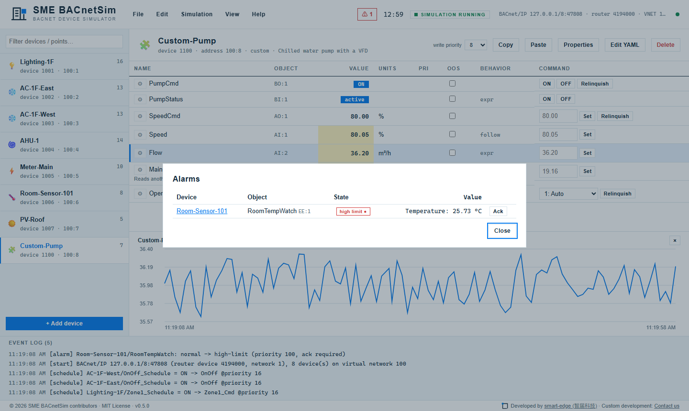

# Alarms (intrinsic reporting)

`type: nc` (or `notification-class`) creates a Notification Class object; its `instance` is the
notification class number. The web UI lists notification classes in the device's object list (read-only:
priorities, ack-required flags and recipients; edit them in the configuration).



| key | meaning |
|---|---|
| `priority` | `[to-offnormal, to-fault, to-normal]`, default `[100, 100, 200]` |
| `ack_required` | 3 flags, default `[true, true, false]` |
| `recipients` | list of `{device: <id>` and/or `address: "<net>:<mac>" \| "<ip>:<port>", process_id, confirmed, transitions: [3 flags], from_time, to_time, days}` |

A recipient given only by `device` is resolved with Who-Is (another simulated device directly; otherwise
the Who-Is goes out through the router, so the recipient must listen on the simulator's UDP port, usually a
BMS on another host). An `address` (`"<ip>:<port>"` means a station on the BACnet/IP side) skips the lookup.

Any value object can carry an `alarm` block that enables intrinsic reporting:

```yaml
- type: ai
  name: RoomTemp
  alarm: {notification_class: NC1, high_limit: 30, low_limit: 15, deadband: 0.5, time_delay: 60}
- {type: bi, name: FilterAlarm, alarm: {notification_class: 1, alarm_value: active}}
- {type: msi, name: Status, states: [Stopped, Running, Fault], alarm: {notification_class: 1, fault_values: [Fault]}}
```

| key | meaning |
|---|---|
| `notification_class` | name or instance of a notification-class object in the same device |
| `high_limit`, `low_limit`, `deadband`, `limit_enable` | analog (OUT_OF_RANGE); `limit_enable` `[low, high]` defaults to the limits that are set |
| `alarm_value` | binary (CHANGE_OF_STATE): `active` / `inactive` |
| `alarm_values`, `fault_values` | multi-state: state numbers or texts; a fault value puts the object in `fault` |
| `time_delay`, `time_delay_normal` | **simulated** seconds (default 0 / `time_delay`) |
| `event_enable` | `[to-offnormal, to-fault, to-normal]`, default all true |
| `notify_type` | `alarm` (default) or `event` |

Event states are evaluated on the simulated clock (time delays follow the speed and stop while paused;
writes are evaluated immediately). Transitions update Event_State, Event_Time_Stamps, Acked_Transitions and
the in-alarm status flag, are sent as Confirmed / UnconfirmedEventNotification to the recipients, and appear
in the event log. The simulator answers AcknowledgeAlarm, GetEventInformation, GetAlarmSummary and
GetEnrollmentSummary (all filters, including the enrollment filter = recipient + process identifier of the
object's notification class); the web UI shows an alarm badge per row, an
**Ack** button, the active-alarm count in the header and *View → Alarms*. The `split_ac`, `ahu` and
`power_meter` templates add `NC1` (no recipients) and a few alarms; set the template parameter
`alarms: false` to leave them out. `split_ac`'s RoomTemp high limit (template parameter `high_limit`,
default 35 °C) is an overheat alarm above the template's ambient peak (33 °C), so the demo starts and runs
without alarms while the ACs follow their schedules; to see one, write `high-limit` (e.g. 28) from a client.

BACnet writes (WriteProperty / WritePropertyMultiple) to `event-enable`, `limit-enable`, `high-limit`,
`low-limit`, `deadband`, `time-delay`, `time-delay-normal`, `notification-class` (must be a notification-class
object of the device) and `alarm-value` / `alarm-values` take effect and are written into the config, so
Save / Export keep them. `acked-transitions` is read-only (WriteProperty answers `write-access-denied`).

WritePropertyMultiple validates every item first (object exists, property exists, array index, datatype, the
alarm property rules above, Priority_Array of commandable objects) and writes nothing if one fails; the
error names the first failing object / property. Value checks done only inside an object's own write hook
(e.g. trend log / schedule range checks) still run while writing, so such a failure can leave the earlier
items of the request applied.

bacpypes3 0.1.0 cannot decode a GetAlarmSummary / GetEnrollmentSummary ACK whose list is empty (a filter
that matches nothing) and reports it as `invalid-tag`; the simulator itself encodes the empty ACK correctly
and patches the decoder for bacpypes3 clients running in the same process (`sme_bacnet_sim/alarm.py`).
Other bacpypes3 0.1.0 clients see the same error until they apply the same fix.
A multi-state object that is already `offnormal` and changes to a different alarm value makes a new
`offnormal -> offnormal` transition (and notification) after `time_delay`.

Limitations: bacpypes3's own intrinsic-reporting algorithms run on the wall clock, so the simulator uses its
own (see `sme_bacnet_sim/alarm.py`).

Not supported: acknowledgment notifications (notify type `ack-notification`). AcknowledgeAlarm is answered and
updates Acked_Transitions, but no notification is sent to recipients. Exact all-or-nothing semantics of
WritePropertyMultiple beyond the up-front validation above (rollback of already applied writes). SME BACnetSim is free and is built from
public sources only; behaviors that can only be specified from the paid ASHRAE 135 text are left out.
