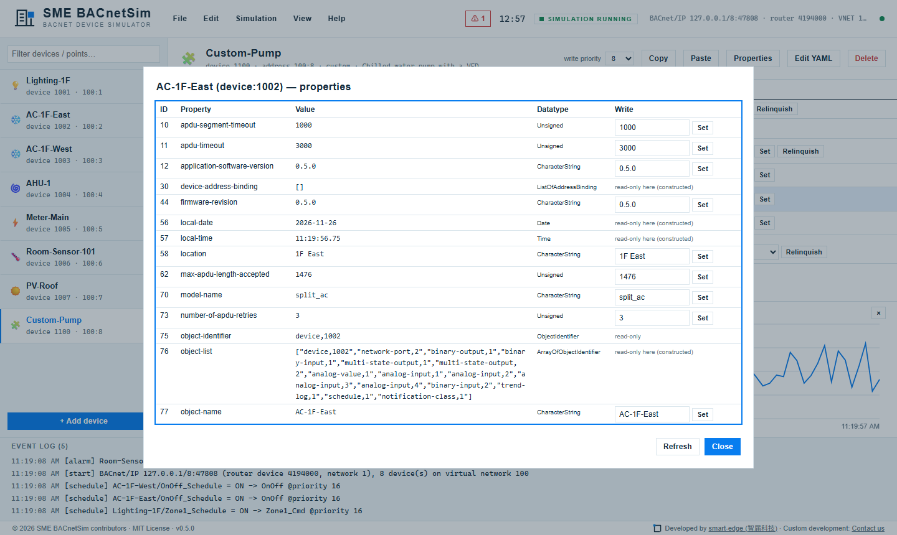

# Copy / paste and the property grid

- **Devices**: *Copy* in the device header (or right-click a device in the list, or Ctrl+C with no point selected),
  then *Paste* (header button, *Edit → Paste* or Ctrl+V) adds a duplicate with the next free device ID after the
  source and the name `Name (copy)`. The duplicate is written to the configuration like *Add device*.
- **Points**: select rows with Ctrl / Shift click, Ctrl+C (or *Edit → Copy*), select a device (the same or another
  one) and Ctrl+V. Each pasted object gets the next free instance of its type and, on a name clash, a
  `(copy)` suffix. References (`log_object`, schedule `targets` / exception `calendar`, `input_object`, loop
  `*_object`, `monitored_object`, `notification_class`, `alarm.notification_class`) are kept by name; a reference
  to an object pasted in the same batch follows the renamed copy. When a referenced name does not exist in the
  target device the object is not pasted and the reason is shown and written to the event log.
  Ctrl+C / Ctrl+V only act while no text field or dialog has the focus; the clipboard lives in the page memory.
- **Properties**: the ⚙ button on a row (or *Properties* in the device header for the device object) lists every
  property of the BACnet object, ordered by property identifier, with value, datatype and whether it can be
  written. Writes take the same path as a BACnet WriteProperty request (same checks, alarm properties written
  back to the configuration); a commandable Present_Value is written at a chosen priority or relinquished.
  Only basic types (real, double, unsigned, integer, boolean, enumerated, character string) can be edited;
  constructed values (arrays, lists, sequences) are shown as JSON and are read-only in the UI. Object_Identifier,
  Object_Type and Property_List are never written from the UI.

