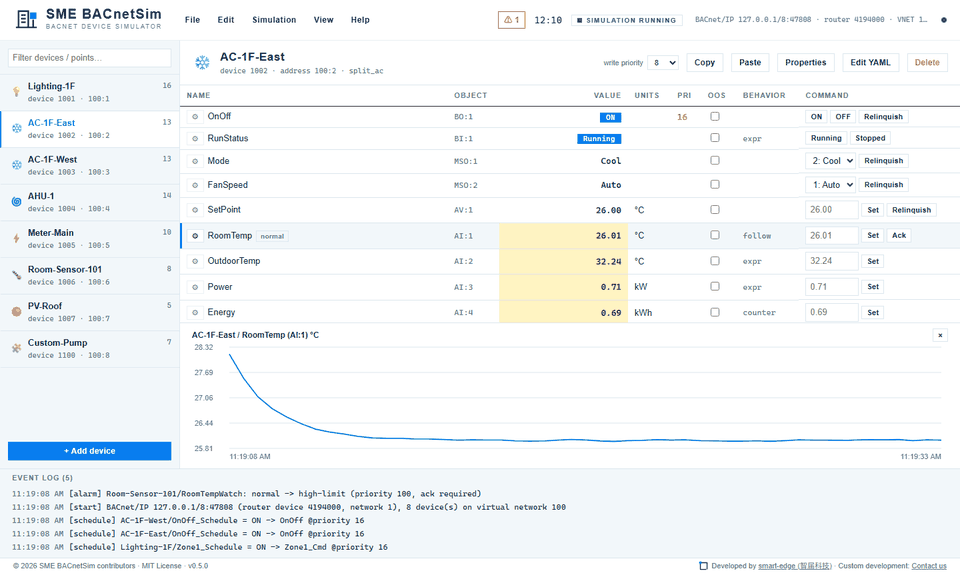

# SME BACnetSim

A free, open-source BACnet/IP device simulator (a BACnet server / device emulator) with a live web UI,
for Windows, Linux and Docker. Simulate lighting controllers, air conditioners, AHUs,
power meters, sensors, PV inverters — or any device you describe in YAML — and watch their values change
in the browser while a real BACnet client (Yabe, Niagara, your own EMS…) reads and commands them.

- **Many devices on one port.** A built-in BACnet router owns UDP 47808; every simulated device sits on a
  virtual network behind it (default network 100), so clients discover them all with one Who-Is.
- **Realistic behavior.** Room temperature follows the set point when the AC is on, energy integrates power,
  lights report feedback and power, PV output follows a day curve and respects a curtailment limit.
- **Real BACnet semantics.** Commandable outputs with a 16-level priority array and relinquish,
  out-of-service override, COV increments, Device / Network Port objects.
- **Configurable.** Import / export YAML or JSON, edit any device as YAML in the browser, add devices from
  templates, or save back to the config file.
- **Live UI.** Values stream over WebSocket, trend chart per point, event log of BACnet and UI writes.
- **English, Japanese and Simplified Chinese.** The UI follows the browser language; switch it under
  View → Language.

Built on [bacpypes3](https://github.com/JoelBender/BACpypes3) (asyncio BACnet stack, supports BACnet/IP,
IPv6 and BACnet/SC) and FastAPI. No front-end build step.

SME BACnetSim is free and MIT-licensed, developed by [smart-edge (智届科技)](https://smartedge-tech.com) —
custom development is available, see [Commercial support & custom development](commercial-support.md).

## Typical uses

- **Test a BACnet client without hardware.** Point your BMS, EMS, gateway or SCADA driver at the simulator
  instead of real controllers.
- **Reproduce a site on your desk.** [Clone real devices](cloning.md), or import an [EDE file](ede.md) or an
  [Excel point list](excel.md).
- **Demos, training and automated tests.** Run it with Python or Docker and drive it through the
  [HTTP API](http-api.md).

## More simulators from smart-edge

SME BACnetSim is one of a series of free, MIT-licensed protocol simulators by smart-edge. They share the
same web UI and conventions, so what you learn in one carries over to the others.

| Simulator | What it simulates | Docs |
|---|---|---|
| **SME BACnetSim** (this project) | BACnet/IP device simulator | [Docs](https://smartedge-tech-dev.github.io/sme-bacnet-sim/) |
| [SME ModbusSim](https://github.com/smartedge-tech-dev/sme-modbus-sim) | Modbus TCP / RTU / UDP / TLS slave (server) simulator | [Docs](https://smartedge-tech-dev.github.io/sme-modbus-sim/) |
| [SME OCPPSim](https://github.com/smartedge-tech-dev/sme-ocpp-sim) | OCPP 1.6J / 2.0.1 charging station (charge point) simulator | [Docs](https://smartedge-tech-dev.github.io/sme-ocpp-sim/) |

All open-source tools from smart-edge: <https://smartedge-tech.com/open-source/>
