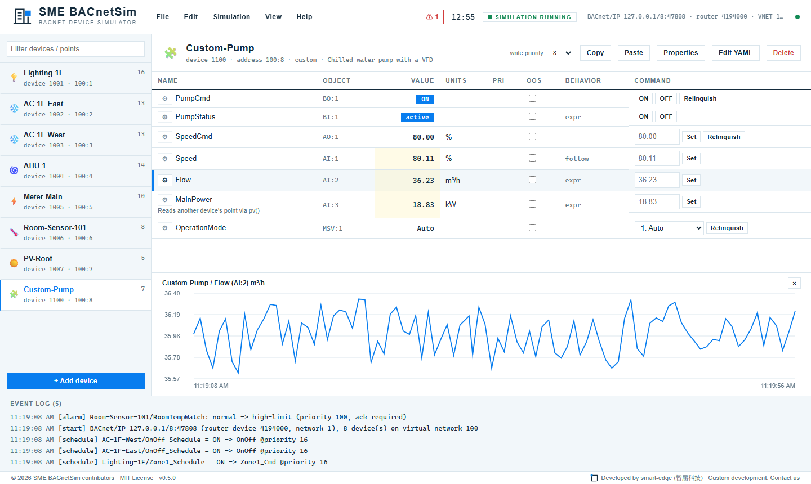

# Objects

| Key | Notes |
|---|---|
| `type` | `ai ao av bi bo bv msi mso msv acc pc loop file prog tl sch cal nc ee` (or full names such as `analog-input`, `trend-log`, `schedule`, `calendar`, `notification-class`, `event-enrollment`) |
| `instance` | optional; auto-numbered per type |
| `name`, `description` | `name` is also the variable name in expressions |
| `units` | BACnet engineering units, e.g. `degrees-celsius`, `kilowatts`, `percent` |
| `value` | initial value (binary: 0/1, multi-state: 1-based index) |
| `states` | multi-state texts |
| `active_text`, `inactive_text` | binary texts (quote `"ON"`/`"OFF"` — YAML reads them as booleans) |
| `commandable` | for `av/bv/msv`; outputs are always commandable |
| `min`, `max`, `cov_increment` | analog limits and COV increment |
| `behavior` | how the value is simulated (below) |
| `log_object`, `log_property`, `log_interval`, `logging_type`, `client_cov_increment`, `buffer_size`, `enabled` | trend logs only (below) |
| `weekly`, `exceptions`, `default`, `targets`, `priority_for_writing`, `effective_period` | schedules only (below) |
| `dates` | calendars only (below) |
| `scale`, `prescale` | accumulators only (below) |
| `scale_factor`, `input_object` | pulse converters only (below) |
| `controlled_object`, `manipulated_object`, `setpoint`, `setpoint_object`, `proportional_constant`, `integral_constant`, `derivative_constant`, `bias`, `action`, `update_interval` | loops only (below) |
| `file_type`, `access`, `content`, `path`, `read_only`, `program_state`, `instance_of`, `program_location` | files and programs only (below) |
| `monitored_object`, `event_type`, `event_parameters`, `notification_class`, `event_enable`, `notify_type`, `time_delay`, `time_delay_normal` | event enrollments only (below) |

