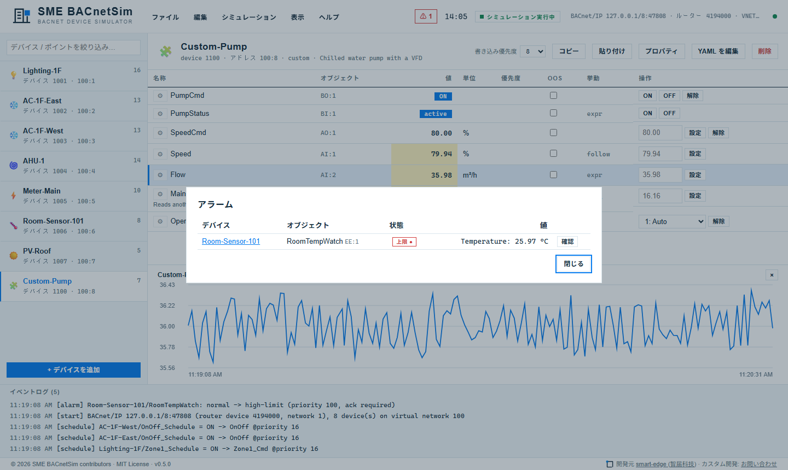

# アラーム（intrinsic reporting）

`type: nc`（または `notification-class`）は Notification Class オブジェクトを作成します。その `instance` が
通知クラス番号です。Web UI はデバイスのオブジェクト一覧に通知クラスを表示します（読み取り専用:
優先度、ack-required フラグ、受信先。編集は設定ファイルで行います）。



| キー | 意味 |
|---|---|
| `priority` | `[to-offnormal, to-fault, to-normal]`、デフォルトは `[100, 100, 200]` |
| `ack_required` | 3 つのフラグ、デフォルトは `[true, true, false]` |
| `recipients` | `{device: <id>` および/または `address: "<net>:<mac>" \| "<ip>:<port>", process_id, confirmed, transitions: [3 flags], from_time, to_time, days}` のリスト |

`device` のみで指定された受信先は Who-Is で解決されます（他のシミュレートされたデバイスなら直接。それ以外の場合、
Who-Is はルータ経由で送出されるため、受信先はシミュレータの UDP ポートで待ち受けている必要があり、通常は
別ホスト上の BMS です）。`address`（`"<ip>:<port>"` は BACnet/IP 側のステーションを意味します）を指定すると検索は省略されます。

任意の値オブジェクトに、intrinsic reporting を有効にする `alarm` ブロックを持たせることができます:

```yaml
- type: ai
  name: RoomTemp
  alarm: {notification_class: NC1, high_limit: 30, low_limit: 15, deadband: 0.5, time_delay: 60}
- {type: bi, name: FilterAlarm, alarm: {notification_class: 1, alarm_value: active}}
- {type: msi, name: Status, states: [Stopped, Running, Fault], alarm: {notification_class: 1, fault_values: [Fault]}}
```

| キー | 意味 |
|---|---|
| `notification_class` | 同一デバイス内の notification-class オブジェクトの名前またはインスタンス |
| `high_limit`, `low_limit`, `deadband`, `limit_enable` | アナログ（OUT_OF_RANGE）。`limit_enable` `[low, high]` のデフォルトは設定されている上下限 |
| `alarm_value` | バイナリ（CHANGE_OF_STATE）: `active` / `inactive` |
| `alarm_values`, `fault_values` | マルチステート: 状態番号またはテキスト。fault 値になるとオブジェクトは `fault` になります |
| `time_delay`, `time_delay_normal` | **シミュレーション時間**の秒（デフォルトは 0 / `time_delay`） |
| `event_enable` | `[to-offnormal, to-fault, to-normal]`、デフォルトはすべて true |
| `notify_type` | `alarm`（デフォルト）または `event` |

イベント状態はシミュレーション時計で評価されます（時間遅延は速度に従い、一時停止中は止まります。
書き込みは即座に評価されます）。遷移は Event_State、Event_Time_Stamps、Acked_Transitions、
および in-alarm ステータスフラグを更新し、受信先へ Confirmed / UnconfirmedEventNotification として送信され、イベントログにも
表示されます。シミュレータは AcknowledgeAlarm、GetEventInformation、GetAlarmSummary、
GetEnrollmentSummary に応答します（オブジェクトの通知クラスの受信先 + プロセス識別子による enrollment フィルタを含むすべてのフィルタ）。Web UI には行ごとのアラームバッジ、
**確認** ボタン、ヘッダーのアクティブアラーム数、および 表示 → アラーム が用意されています。`split_ac`、`ahu`、
`power_meter` テンプレートは `NC1`（受信先なし）といくつかのアラームを追加します。除外するにはテンプレートパラメータ
`alarms: false` を設定してください。`split_ac` の RoomTemp の上限（テンプレートパラメータ `high_limit`、
デフォルト 35 °C）は、テンプレートの外気温ピーク（33 °C）を上回るオーバーヒートアラームであるため、エアコンがスケジュールに従っている間、デモはアラームなしで起動・動作します。
アラームを確認するには、クライアントから `high-limit`（例: 28）を書き込んでください。

`event-enable`、`limit-enable`、`high-limit`、
`low-limit`、`deadband`、`time-delay`、`time-delay-normal`、`notification-class`（デバイスの notification-class
オブジェクトである必要があります）、`alarm-value` / `alarm-values` への BACnet 書き込み（WriteProperty / WritePropertyMultiple）は
反映され、設定にも書き込まれるため、
保存 / エクスポートでも維持されます。`acked-transitions` は読み取り専用です（WriteProperty は `write-access-denied` を返します）。

WritePropertyMultiple はまずすべての項目を検証し（オブジェクトの存在、プロパティの存在、配列インデックス、データ型、上記の
アラームプロパティのルール、コマンド可能なオブジェクトの Priority_Array）、1 つでも失敗した場合は何も書き込みません。
エラーは最初に失敗したオブジェクト / プロパティを示します。オブジェクト自身の書き込みフック内でのみ行われる値チェック
（例: Trend Log / Schedule の範囲チェック）は書き込み中に実行されるため、そのような失敗では、リクエストの先行する
項目が適用されたままになることがあります。

bacpypes3 0.1.0 は、リストが空の GetAlarmSummary / GetEnrollmentSummary ACK（何にも一致しないフィルタ）をデコードできず、
`invalid-tag` として報告します。シミュレータ自身は空の ACK を正しくエンコードし、
同一プロセス内で動作する bacpypes3 クライアント向けにデコーダへパッチを当てます（`sme_bacnet_sim/alarm.py`）。
他の bacpypes3 0.1.0 クライアントは、同じ修正を適用するまで同じエラーになります。
すでに `offnormal` のマルチステートオブジェクトが別のアラーム値に変化すると、`time_delay` の後に新しい
`offnormal -> offnormal` 遷移（および通知）が発生します。

制限事項: bacpypes3 自身の intrinsic reporting アルゴリズムは実時計で動作するため、シミュレータは
独自のものを使用します（`sme_bacnet_sim/alarm.py` を参照）。

サポートしていません: acknowledgment notification（通知タイプ `ack-notification`）。AcknowledgeAlarm には応答し、
Acked_Transitions も更新しますが、受信先への通知は送信されません。また、上記の事前検証を超える WritePropertyMultiple の厳密な all-or-nothing セマンティクス（適用済みの書き込みのロールバック）にも対応していません。SME BACnetSim は無償で、
公開情報のみから構築されています。有償の ASHRAE 135 の本文からしか仕様を確定できない挙動は対象外としています。
