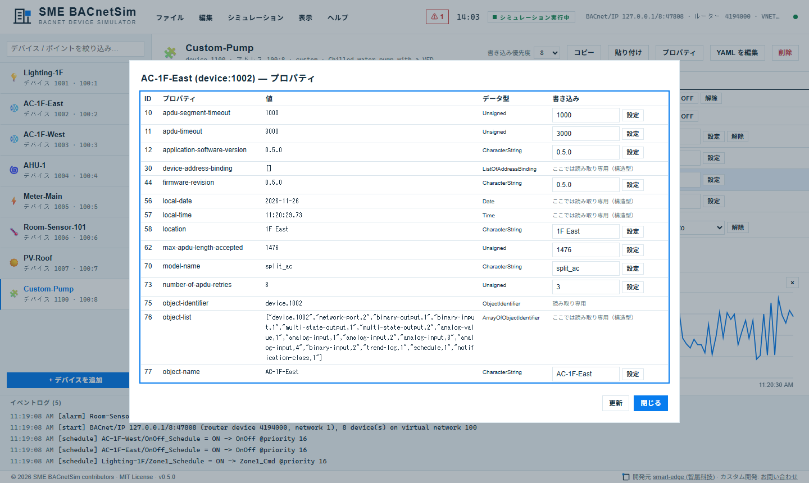

# コピー / 貼り付けとプロパティグリッド

- **デバイス**: デバイスヘッダーの「コピー」（または一覧のデバイスを右クリック、ポイント未選択時の Ctrl+C）の後、
  「貼り付け」（ヘッダーのボタン、「編集 → 貼り付け」、Ctrl+V）で複製を追加します。デバイス ID はコピー元の次の空き番号、
  名前は `Name (copy)` です。「デバイスを追加」と同様に設定へ反映されます。
- **ポイント**: Ctrl / Shift クリックで行を選択して Ctrl+C（または「編集 → コピー」）、デバイス（同じでも別でも可）を
  選択して Ctrl+V。貼り付けたオブジェクトは型ごとの次の空きインスタンス番号を使い、名前が重なると `(copy)` を付けます。
  参照（`log_object`、スケジュールの `targets` / 例外の `calendar`、`input_object`、ループの `*_object`、
  `monitored_object`、`notification_class`、`alarm.notification_class`）は名前のまま保持し、同じ貼り付けに含まれる
  オブジェクトへの参照は名前を変えたコピーを指します。参照先の名前が貼り付け先デバイスに無いオブジェクトは貼り付けず、
  理由を表示してイベントログに記録します。Ctrl+C / Ctrl+V はテキスト入力やダイアログにフォーカスが無いときだけ働きます。
  クリップボードはページ内メモリです。
- **プロパティ**: 行の ⚙ ボタン（デバイスオブジェクトはヘッダーの「プロパティ」）で BACnet オブジェクトの全プロパティを
  プロパティ識別子順に、値・データ型・書き込み可否とともに表示します。書き込みは BACnet WriteProperty 要求と同じ経路を
  通ります（同じチェック、アラームプロパティの設定への書き戻し）。コマンダブルな Present_Value は優先度を選んで書き込み、
  または解除できます。編集できるのは基本型（real、double、unsigned、integer、boolean、enumerated、character string）
  のみで、構造型（配列・リスト・シーケンス）は JSON で表示し UI からは読み取り専用です。Object_Identifier・Object_Type・
  Property_List は UI から書き込みません。

