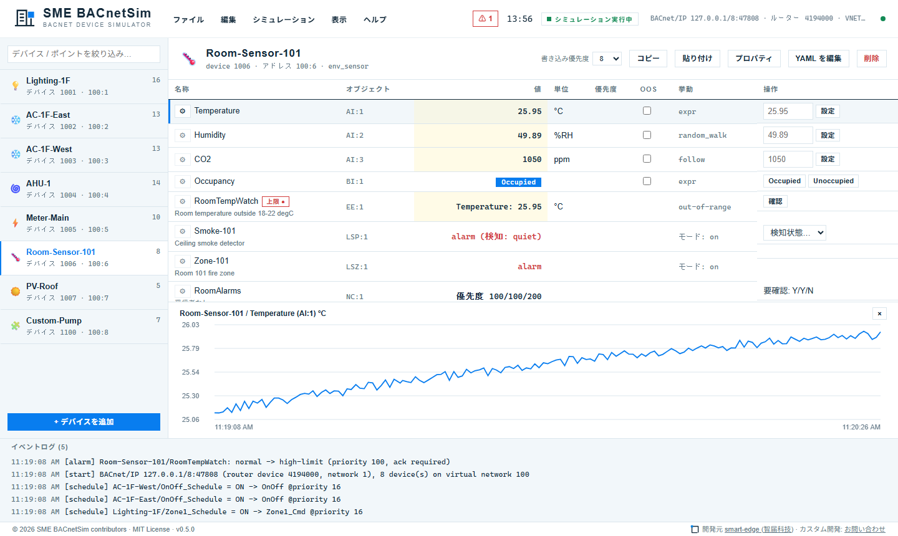

# イベントエンロールメント（algorithmic reporting）

`type: ee`（または `event-enrollment`）は Event Enrollment オブジェクトを作成します。同じデバイスの別の値オブジェクトの
present-value を監視し、Notification Class 経由で通知するため、`alarm` ブロックを持たないポイント（テンプレートの温度など）でも
アラームを出せます：



```yaml
- type: ee
  name: RoomTempWatch
  monitored_object: Temperature
  event_type: out-of-range
  event_parameters: {low_limit: 18, high_limit: 28, deadband: 0.5}
  notification_class: RoomAlarms
  time_delay: 60
- {type: ee, name: ModeWatch, monitored_object: OperationMode, event_type: change-of-state,
   event_parameters: {alarm_values: [Maintenance]}, notification_class: 1, notify_type: event}
```

| キー | 意味 |
|---|---|
| `monitored_object` | 同じデバイスの値オブジェクト名（Object_Property_Reference = その present-value） |
| `event_type` | `out-of-range`（アナログ、Accumulator を除く）または `change-of-state`（バイナリ / マルチステート） |
| `event_parameters` | out-of-range：`low_limit`、`high_limit`（両方必須・常に有効）、`deadband`；change-of-state：`alarm_values`（状態番号またはテキスト、バイナリは `active` / `inactive`） |
| `notification_class` | 同じデバイスの notification-class オブジェクトの名前またはインスタンス |
| `time_delay`、`time_delay_normal` | **シミュレーション**秒（既定 0 / `time_delay`）；`time_delay` は Event_Parameters の Time_Delay |
| `event_enable` | `[to-offnormal, to-fault, to-normal]`、既定はすべて true |
| `notify_type` | `alarm`（既定）または `event` |

イベントエンロールメントは intrinsic reporting と同じイベント状態遷移、通知、AcknowledgeAlarm、
GetEventInformation / GetAlarmSummary / GetEnrollmentSummary、Web UI（バッジと **確認** ボタン付きの行、表示 → アラーム）を使います。
`event-parameters`（同じイベントタイプ）、`event-enable`、`notify-type`、`time-delay-normal`、`notification-class` への
BACnet 書き込みは反映され、設定にも書き戻されます。`acked-transitions` は読み取り専用です。デモ設定の `Room-Sensor-101` に
1 つあります。EDE エクスポートにはイベントエンロールメント（オブジェクトタイプ 9）が出力されます。EDE インポートでは
警告付きでスキップします（EDE は監視対象やパラメータを持たないため）。

Not supported：イベントタイプ `floating-limit`、`change-of-value` およびその他すべて（正確なアルゴリズムは ASHRAE 135 にのみ
規定）、イベントエンロールメントの故障検出（`fault` 状態 / change-of-reliability なし）、他デバイスのオブジェクトや
present-value 以外のプロパティの監視、BACnet 書き込みによる `event-type` / `object-property-reference` の変更、
CreateObject / DeleteObject によるイベントエンロールメントの作成 / 削除。イベントエンロールメントが監視している値オブジェクトは
削除できません。
