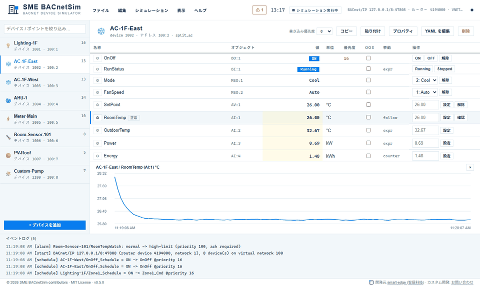

# SME BACnetSim

ライブ Web UI を備えた、無料・オープンソース（MIT）の BACnet/IP デバイスシミュレータ（BACnet サーバ
エミュレータ）です。Windows / Linux / Docker で動作します。照明コントローラ、エアコン、AHU、
電力メータ、センサ、PV インバータ、あるいは YAML で記述した任意のデバイスをシミュレートし、実際の BACnet クライアント
（Yabe、Niagara、自作の EMS など）が読み取り・操作している間、その値の変化をブラウザ上で確認できます。

- **1 つのポートで多数のデバイス。** 内蔵の BACnet ルータが UDP 47808 を占有し、シミュレートされる各デバイスは
  その背後の仮想ネットワーク（デフォルトはネットワーク 100）に配置されます。クライアントは 1 回の Who-Is ですべてを検出できます。
- **リアルな挙動。** エアコンが ON のとき室温は設定温度に追従し、電力量は電力を積算し、
  照明はフィードバックと電力を報告し、PV 出力は日変化カーブに従って出力抑制の上限を守ります。
- **本物の BACnet セマンティクス。** 16 レベルの Priority Array と relinquish を備えたコマンド可能な出力、
  out-of-service による上書き、COV increment、Device / Network Port オブジェクトに対応します。
- **設定可能。** YAML / JSON のインポート・エクスポート、ブラウザ上での任意デバイスの YAML 編集、
  テンプレートからのデバイス追加、設定ファイルへの保存が行えます。
- **ライブ UI。** 値は WebSocket でストリーミングされ、ポイントごとのトレンドグラフと、BACnet および UI からの書き込みのイベントログを備えています。
- **英語、日本語、簡体字中国語。** UI はブラウザの言語に従います。表示 → 言語 で切り替えられます。

[bacpypes3](https://github.com/JoelBender/BACpypes3)（asyncio ベースの BACnet スタックで、BACnet/IP、
IPv6、BACnet/SC をサポート）と FastAPI の上に構築されています。フロントエンドのビルド手順は不要です。

SME BACnetSim は無償の MIT ライセンスで、[smart-edge (智届科技)](https://smartedge-tech.com) が開発しています —
カスタム開発も承っています。[商用サポートとカスタム開発](commercial-support.md) をご覧ください。

## 主な用途

- **実機なしで BACnet クライアントを試験。** BEMS、EMS、ゲートウェイ、SCADA ドライバの接続先を、実機の
  コントローラからシミュレータに切り替えるだけです。
- **現場を手元で再現。** [実機デバイスをクローン](cloning.md)するか、[EDE ファイル](ede.md) や
  [Excel ポイントリスト](excel.md) を取り込みます。
- **デモ、教育、自動テスト。** Python または Docker で起動し、[HTTP API](http-api.md) から操作できます。

## smart-edge のシミュレータシリーズ

SME BACnetSim は、smart-edge が公開している無料・MIT ライセンスのプロトコルシミュレータシリーズの 1 つです。
Web UI と操作体系は共通なので、1 つ覚えれば他のシミュレータも同じ感覚で使えます。

| シミュレータ | 対象 | ドキュメント |
|---|---|---|
| **SME BACnetSim**（本プロジェクト） | BACnet/IP デバイスシミュレータ | [ドキュメント](https://smartedge-tech-dev.github.io/sme-bacnet-sim/ja/) |
| [SME ModbusSim](https://github.com/smartedge-tech-dev/sme-modbus-sim) | Modbus TCP / RTU / UDP / TLS スレーブ（サーバー）シミュレーター | [ドキュメント](https://smartedge-tech-dev.github.io/sme-modbus-sim/ja/) |
| [SME OCPPSim](https://github.com/smartedge-tech-dev/sme-ocpp-sim) | OCPP 1.6J / 2.0.1 充電器シミュレーター | [ドキュメント](https://smartedge-tech-dev.github.io/sme-ocpp-sim/ja/) |

smart-edge のオープンソースツール一覧: <https://smartedge-tech.com/open-source/>
