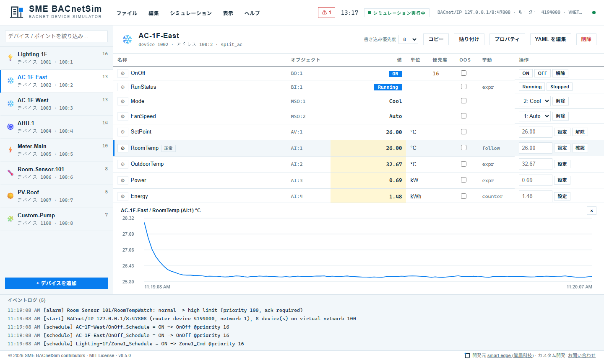
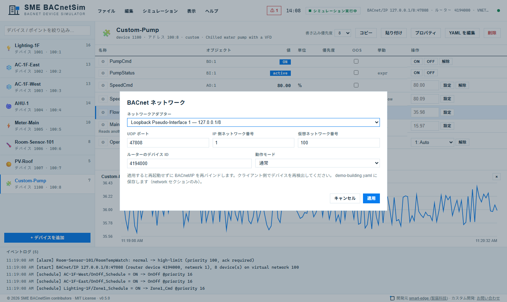

# クイックスタート

```powershell
python -m venv .venv
.venv\Scripts\pip install -r requirements.txt
.venv\Scripts\python -m sme_bacnet_sim --config configs/demo-building.yaml
```



http://127.0.0.1:8080/ を開きます。オプション:

| オプション | 意味 |
|---|---|
| `-c, --config FILE` | YAML/JSON 設定ファイル（デフォルトは `configs/demo-building.yaml`） |
| `--ip 192.168.1.10/24` | BACnet/IP 用の NIC アドレス（デフォルト: 自動検出、/24） |
| `--bacnet-port 47808` | BACnet/IP の UDP ポート |
| `--foreign-bbmd 192.168.2.1[:47808]` | この BBMD に Foreign Device として登録（設定ファイルより優先） |
| `--foreign-ttl 300` | Foreign Device の Time-to-Live（秒、設定ファイルより優先） |
| `--host 0.0.0.0 --http-port 8080` | Web UI のバインドアドレス（デフォルトは localhost のみ） |
| `--browser` | 起動時に Web UI をブラウザで開く（既定では開きません。既定は `--no-browser`） |

## BACnet クライアントの接続

クライアントからは、ルータ（`device 4194000`）が `<ip>:47808` に、シミュレートされたデバイスがそのルータ経由の
`100:1`、`100:2`（ネットワーク 100、MAC 1、2…）といったアドレスに見えます。Yabe では
*Add device → BACnet/IP over UDP* を選び、続けて *Who-Is* を実行します。

> **同一 PC での注意:** Windows では、同じマシン上のクライアントがブロードキャスト応答
> （Who-Is/I-Am）を受信できないことがあります（ユニキャストは動作します）。クライアントを別のマシンで実行するか、シミュレータをクライアントとは別の NIC
> にバインドするか、`network.mode: bbmd` を設定してクライアントを Foreign Device として登録してください。

> **別の UDP ポートのクライアント:** Who-Is / I-Am のブロードキャストはシミュレータのポート（既定 47808）宛てです。
> 別のポート（例: 47809）にバインドしたクライアントは I-Am を受信できず、デバイスが見つかりません。両者を同じポートにするか、
> `network.mode: bbmd` にしてクライアントをシミュレータ（`<シミュレータの IP>:47808`）に Foreign Device として登録してください。
> I-Am の応答がクライアントに転送されます。

## Web UI でのネットワーク設定

*編集 → BACnet ネットワーク…*（またはステータスバーの BACnet/IP アドレスをクリック）で、ネットワークアダプター
（名前とアドレス/プレフィックスの一覧、または*自動検出*）、UDP ポート、IP 側・仮想ネットワーク番号、ルーターのデバイス ID、
動作モード（通常 / BBMD / Foreign Device：BBMD アドレスと TTL）を変更できます。*適用* で設定を検証し（このコンピューターの
アドレスか、UDP ポートが空いているか、ネットワーク番号が異なるか、デバイス ID が一意か）、再起動せずに BACnet/IP を再バインドして、
設定ファイルの `network:` セクションに書き戻します（他のセクションと未保存の変更はそのまま。`network:` 内のコメントは消えます）。
`--ip` / `--bacnet-port` などのコマンドラインオプションは次回起動時も優先されます。変更後はクライアント側でデバイスを再検出してください。
Not supported：Read-Property-Multiple やセグメンテーション対応のオフ（常にオン）。



## Docker

```bash
docker run --rm --network host -e TZ=Asia/Tokyo ghcr.io/smartedge-tech-dev/sme-bacnet-sim:<ver>
```

Who-Is / I-Am のブロードキャストには `--network host`（Linux）が必要です。`TZ` を指定しないとコンテナの時計は UTC になり、
スケジュールと UI の時計もそれに従います（イメージには tzdata が入っています）。
