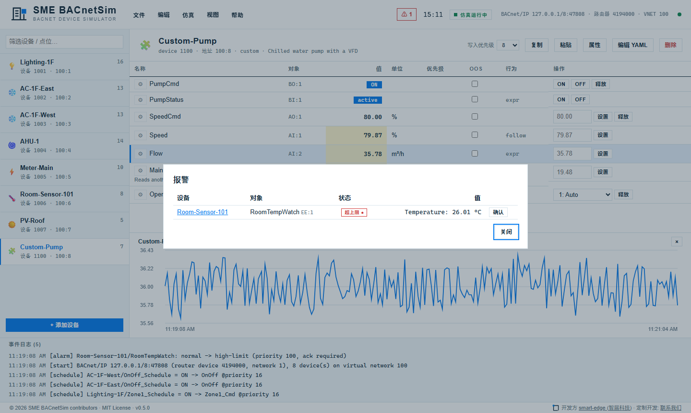

# 报警（Intrinsic Reporting）

`type: nc`（或 `notification-class`）会创建一个 Notification Class 对象；其 `instance` 即 Notification Class 编号。Web UI 在设备的对象列表中列出 Notification Class（只读：优先级、需确认标志和接收方；请在配置中编辑）。



| 键 | 含义 |
|---|---|
| `priority` | `[to-offnormal, to-fault, to-normal]`，默认 `[100, 100, 200]` |
| `ack_required` | 3 个标志，默认 `[true, true, false]` |
| `recipients` | `{device: <id>` 和 / 或 `address: "<net>:<mac>" \| "<ip>:<port>", process_id, confirmed, transitions: [3 flags], from_time, to_time, days}` 的列表 |

仅通过 `device` 指定的接收方会用 Who-Is 解析（另一个模拟设备则直接解析；否则 Who-Is 会经由路由器发出，因此接收方必须监听模拟器的 UDP 端口，通常是另一台主机上的 BMS）。给出 `address`（`"<ip>:<port>"` 表示 BACnet/IP 一侧的站点）则跳过查找。

任何值对象都可以带一个 `alarm` 块来启用 intrinsic reporting：

```yaml
- type: ai
  name: RoomTemp
  alarm: {notification_class: NC1, high_limit: 30, low_limit: 15, deadband: 0.5, time_delay: 60}
- {type: bi, name: FilterAlarm, alarm: {notification_class: 1, alarm_value: active}}
- {type: msi, name: Status, states: [Stopped, Running, Fault], alarm: {notification_class: 1, fault_values: [Fault]}}
```

| 键 | 含义 |
|---|---|
| `notification_class` | 同一设备中某个 notification-class 对象的名称或 instance |
| `high_limit`, `low_limit`, `deadband`, `limit_enable` | 模拟量（OUT_OF_RANGE）；`limit_enable` 为 `[low, high]`，默认取已设置的限值 |
| `alarm_value` | 二进制（CHANGE_OF_STATE）：`active` / `inactive` |
| `alarm_values`, `fault_values` | 多状态：状态号或文本；fault value 会使对象进入 `fault` |
| `time_delay`, `time_delay_normal` | **仿真**秒数（默认 0 / `time_delay`） |
| `event_enable` | `[to-offnormal, to-fault, to-normal]`，默认全部为 true |
| `notify_type` | `alarm`（默认）或 `event` |

事件状态基于仿真时钟求值（延时随仿真速度变化，暂停时停止计时；写入会立即求值）。状态转换会更新 Event_State、Event_Time_Stamps、Acked_Transitions 和 in-alarm 状态标志，以 Confirmed / UnconfirmedEventNotification 发送给接收方，并出现在事件日志中。模拟器会应答 AcknowledgeAlarm、GetEventInformation、GetAlarmSummary 和 GetEnrollmentSummary（支持全部过滤条件，包括 enrollment filter = 对象所属 Notification Class 的接收方 + process identifier）；Web UI 在每一行显示报警徽标和 **确认** 按钮，在标题栏显示活动报警数，并提供 *视图 → 报警*。`split_ac`、`ahu` 和 `power_meter` 模板会添加 `NC1`（无接收方）和若干报警；设置模板参数 `alarms: false` 可去掉它们。`split_ac` 的 RoomTemp 上限（模板参数 `high_limit`，默认 35 °C）是一个高于模板环境温度峰值（33 °C）的过热报警，因此在空调按其 Schedule 运行期间，演示可以无报警地启动和运行；若想看到报警，请从客户端写入 `high-limit`（例如 28）。

向 `event-enable`、`limit-enable`、`high-limit`、`low-limit`、`deadband`、`time-delay`、`time-delay-normal`、`notification-class`（必须是该设备的某个 notification-class 对象）以及 `alarm-value` / `alarm-values` 进行的 BACnet 写入（WriteProperty / WritePropertyMultiple）会生效并写入配置，因此 保存 / 导出 会保留它们。`acked-transitions` 为只读（WriteProperty 返回 `write-access-denied`）。

WritePropertyMultiple 会先校验每一项（对象存在、属性存在、数组索引、数据类型、上述报警属性规则、可命令对象的 Priority_Array），只要有一项失败就不写入任何内容；错误会指明第一个失败的对象 / 属性。仅在对象自身写入钩子内部完成的值检查（例如 Trend Log / Schedule 的范围检查）仍在写入过程中执行，因此此类失败可能导致请求中靠前的项目已被应用。

bacpypes3 0.1.0 无法解码列表为空的 GetAlarmSummary / GetEnrollmentSummary ACK（即过滤条件没有匹配到任何内容），并将其报告为 `invalid-tag`；模拟器自身能正确编码空 ACK，并为运行在同一进程内的 bacpypes3 客户端修补了解码器（`sme_bacnet_sim/alarm.py`）。其他 bacpypes3 0.1.0 客户端在应用同样的修复之前会看到同样的错误。
已处于 `offnormal` 的多状态对象变为另一个报警值时，会在 `time_delay` 之后产生一次新的 `offnormal -> offnormal` 转换（及通知）。

限制：bacpypes3 自带的 intrinsic reporting 算法运行在墙上时钟上，因此模拟器使用自己的实现（见 `sme_bacnet_sim/alarm.py`）。

不支持：确认通知（通知类型 `ack-notification`）。AcknowledgeAlarm 会得到应答并更新 Acked_Transitions，但不会向接收方发送通知。除上述预先校验之外，WritePropertyMultiple 严格的全有或全无语义（回滚已应用的写入）也不支持。SME BACnetSim 免费，且仅基于公开资料构建；只能依据付费的 ASHRAE 135 文本才能确定的行为一律不予实现。
