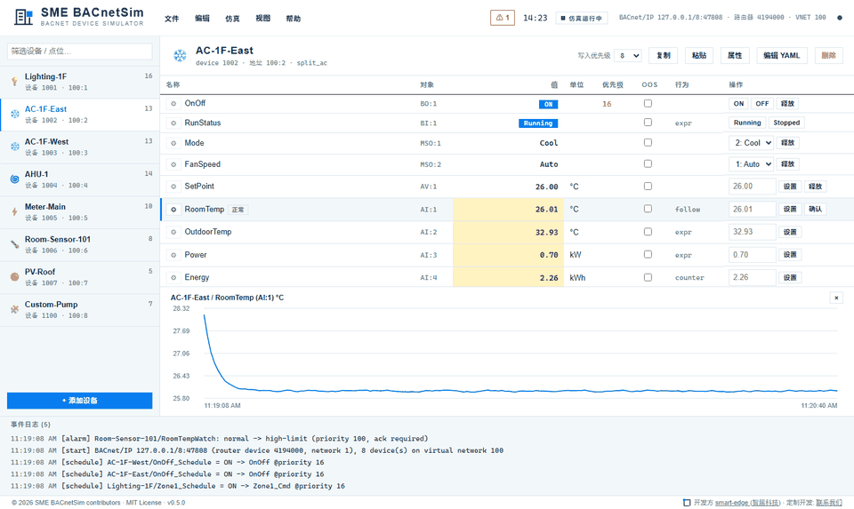

# SME BACnetSim

一个免费开源（MIT）、带实时 Web UI 的 BACnet/IP 设备模拟器（BACnet 仿真软件），支持 Windows、Linux 和 Docker。可以模拟照明控制器、空调、AHU、电能表、传感器、光伏逆变器，或任何用 YAML 描述的设备，并在浏览器中观察它们的数值变化，同时由真实的 BACnet 客户端（Yabe、Niagara、你自己的 EMS……）读取和控制这些设备。

- **一个端口承载多台设备。** 内置的 BACnet 路由器独占 UDP 47808；所有模拟设备都位于它背后的虚拟网络上（默认网络号 100），因此客户端只需一次 Who-Is 即可发现全部设备。
- **行为逼真。** 空调开启时室温会跟随设定值，电能随功率积分，照明会上报反馈和功率，光伏出力遵循日照曲线并受限发（curtailment）上限约束。
- **真实的 BACnet 语义。** 具有 16 级优先级数组和 relinquish 的可命令输出、out-of-service 覆盖、COV 增量，以及 Device / Network Port 对象。
- **可配置。** 可导入 / 导出 YAML 或 JSON，在浏览器中以 YAML 形式编辑任意设备，从模板添加设备，或保存回配置文件。
- **实时 UI。** 数值通过 WebSocket 推送，每个点位都有趋势图，并有记录 BACnet 与 UI 写入的事件日志。
- **英语、日语和简体中文。** UI 跟随浏览器语言；可在 视图 → 语言 中切换。

基于 [bacpypes3](https://github.com/JoelBender/BACpypes3)（asyncio BACnet 协议栈，支持 BACnet/IP、IPv6 和 BACnet/SC）和 FastAPI 构建。无需前端构建步骤。

SME BACnetSim 免费且采用 MIT 许可证，由 [smart-edge (智届科技)](https://smartedge-tech.com) 开发——可提供定制开发，详见 [商业支持与定制开发](commercial-support.md)。

## 典型用途

- **无需硬件即可测试 BACnet 客户端。** 把 BMS、EMS、网关或 SCADA 驱动的连接目标从真实控制器换成模拟器即可。
- **在桌面上复现现场。** [克隆真实设备](cloning.md)，或导入 [EDE 文件](ede.md)、[Excel 点表](excel.md)。
- **演示、培训与自动化测试。** 用 Python 或 Docker 启动，并通过 [HTTP API](http-api.md) 驱动。

## smart-edge 模拟器系列

SME BACnetSim 是 smart-edge 免费、MIT 许可的协议模拟器系列之一。各模拟器共用同一套 Web UI 和操作方式，学会一个即可上手其他几个。

| 模拟器 | 模拟对象 | 文档 |
|---|---|---|
| **SME BACnetSim**（本项目） | BACnet/IP 设备模拟器 | [文档](https://smartedge-tech-dev.github.io/sme-bacnet-sim/zh/) |
| [SME ModbusSim](https://github.com/smartedge-tech-dev/sme-modbus-sim) | Modbus TCP / RTU / UDP / TLS 从站（Slave）模拟器 | [文档](https://smartedge-tech-dev.github.io/sme-modbus-sim/zh/) |
| [SME OCPPSim](https://github.com/smartedge-tech-dev/sme-ocpp-sim) | OCPP 1.6J / 2.0.1 充电桩模拟器 | [文档](https://smartedge-tech-dev.github.io/sme-ocpp-sim/zh/) |

smart-edge 全部开源工具：<https://smartedge-tech.com/zh/open-source/>
