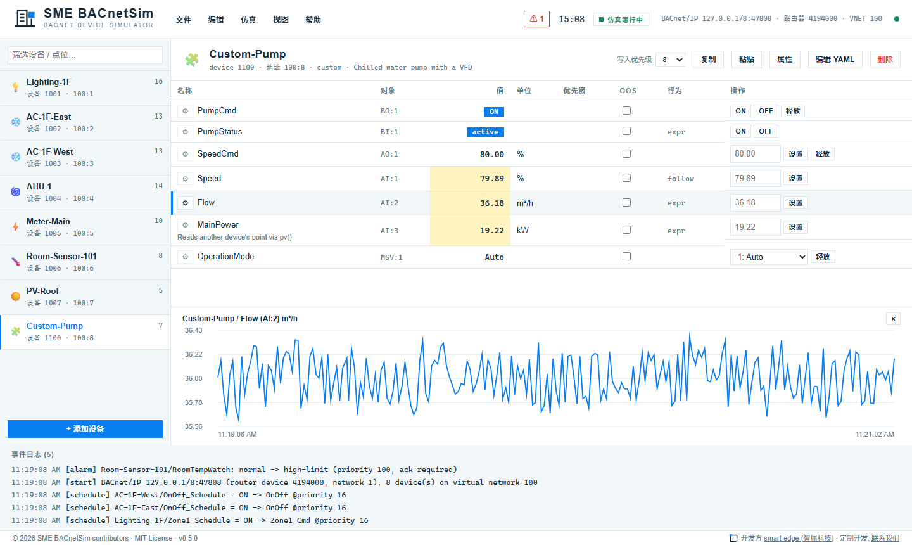

# 对象

| 键 | 说明 |
|---|---|
| `type` | `ai ao av bi bo bv msi mso msv acc pc loop file prog tl sch cal nc ee`（或完整名称，如 `analog-input`、`trend-log`、`schedule`、`calendar`、`notification-class`、`event-enrollment`） |
| `instance` | 可选；按类型自动编号 |
| `name`, `description` | `name` 同时也是表达式中的变量名 |
| `units` | BACnet 工程单位，例如 `degrees-celsius`、`kilowatts`、`percent` |
| `value` | 初始值（二进制：0/1，多状态：从 1 开始的索引） |
| `states` | 多状态文本 |
| `active_text`, `inactive_text` | 二进制文本（`"ON"`/`"OFF"` 需加引号——YAML 会把它们读成布尔值） |
| `commandable` | 用于 `av/bv/msv`；输出对象始终可命令 |
| `min`, `max`, `cov_increment` | 模拟量的上下限和 COV 增量 |
| `behavior` | 数值如何被模拟（见下文） |
| `log_object`, `log_property`, `log_interval`, `logging_type`, `client_cov_increment`, `buffer_size`, `enabled` | 仅用于 Trend Log（见下文） |
| `weekly`, `exceptions`, `default`, `targets`, `priority_for_writing`, `effective_period` | 仅用于 Schedule（见下文） |
| `dates` | 仅用于 Calendar（见下文） |
| `scale`, `prescale` | 仅用于 Accumulator（见下文） |
| `scale_factor`, `input_object` | 仅用于 Pulse Converter（见下文） |
| `controlled_object`, `manipulated_object`, `setpoint`, `setpoint_object`, `proportional_constant`, `integral_constant`, `derivative_constant`, `bias`, `action`, `update_interval` | 仅用于 Loop（见下文） |
| `file_type`, `access`, `content`, `path`, `read_only`, `program_state`, `instance_of`, `program_location` | 仅用于 File / Program（见下文） |
| `monitored_object`, `event_type`, `event_parameters`, `notification_class`, `event_enable`, `notify_type`, `time_delay`, `time_delay_normal` | 仅用于 Event Enrollment（见下文） |

